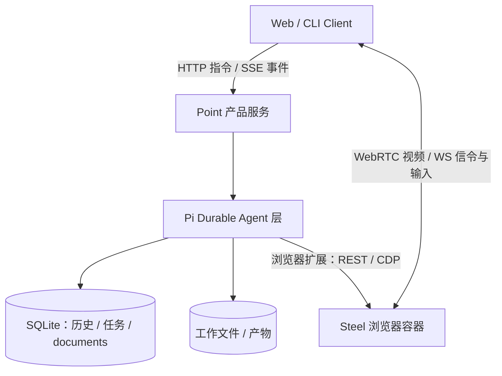

# Point

一个人的、持续运行的 personal agent。参考 Muse 的产品形态：长期主会话、可持续的主题侧聊、独立后台执行、共享记忆、可观看与接管的浏览器、可交付的产物。**只服务一个人**，不建设多用户、租户、团队或角色系统。

> **当前状态：可运行原型阶段，尚未产品化。** 执行与恢复、会话与任务链路、浏览器接管互斥已有进程级验收；正式 Server 已建立 WP1a 基础骨架，产品能力迁移、Web 客户端、Steel 原生 RTC 控制权、鉴权与常驻部署仍待实现。判断依据见[项目现状分析](docs/project-status-2026-10-19.md)，证据数字见[验证状态](docs/design/verification-status.md)。

## 架构



| 层 | 负责 | 选型 |
|---|---|---|
| Point | main/侧聊关系、产品任务与目标、记忆策略、触发判断、结果路由、通知、浏览器控制权 | 本项目 |
| Agent | 模型—工具循环、上下文与压缩、持久任务、checkpoint 与恢复 | `@earendil-works/pi-durable` 1.3.0（锁定） |
| 浏览器 | Chromium、session、CDP、画面采集与 RTC | Steel 固定 digest 镜像 |

设计决定与理由见[设计总览](docs/design/README.md)；两次选型反转的记录见 [ADR-001](docs/design/adr/ADR-001-agent-layer-selection.md)。

## 仓库结构

| 路径 | 内容 |
|---|---|
| [`apps/server/`](apps/server/README.md) | 正式 Server 基础骨架；产品链路待 WP1b 迁移 |
| [`infra/pi-durable-validation/`](infra/pi-durable-validation/README.md) | **当前活跃实现**：可运行原型、CLI、故障注入、真实 Steel/WebRTC 验收 |
| [`infra/pi-durable-validation/evidence/`](infra/pi-durable-validation/evidence/README.md) | 已入库的验收证据（JSON + SHA-256 清单 + 复现命令） |
| [`docs/design/`](docs/design/README.md) | 现行设计与实施顺序 |
| [`docs/design/verification-status.md`](docs/design/verification-status.md) | **验证数字与时点的唯一口径** |
| [`docs/research/`](docs/research) | 调研时点结论（保留历史，不代表现行选型） |
| [`server/`](server/README.md) | 旧 Pi coding-agent SDK 验证工程（历史参考，不参与运行） |
| [`infra/agent-browser/`](infra/agent-browser/README.md) · [`infra/dsh-validation/`](infra/dsh-validation/README.md) | 已退役的浏览器与 DSH 候选验证（保留否决理由与实测数据） |
| [`openspec/`](openspec/config.yaml) | 本次 WP1a 规格与实施记录 |

## 正式 Server 骨架

架构入口：[长期 Server 架构](docs/design/server-architecture.md) · [实施路线](docs/design/roadmap.md) · [NanoMuse 架构分析](docs/research/nanomuse-architecture-2026-10-19.md)。

```bash
npm ci --ignore-scripts
npm run check
npm test
npm run build
npm start
```

默认 `127.0.0.1:4310`，仅提供基础健康接口，尚无聊天/任务/模型执行功能。详情见 [Server README](apps/server/README.md)。以下原型入口仍用于体验既有产品能力。

## 快速开始

需要 Node.js ≥ 22.19、npm。

```bash
cd infra/pi-durable-validation
npm ci --ignore-scripts

# 离线体验：脚本模型，不请求付费模型；调度、工具、SQLite、HTTP、进程恢复都真实执行
npm start

# 另一个终端
npm run cli
```

真实模型（凭据只从环境变量或只读文件读取，不要写进仓库）：

```bash
DEEPSEEK_API_KEY=... npm start -- --model deepseek/deepseek-flash --data runtime/deepseek
# 或：POINT_AUTH_FILE=/绝对路径/auth.json npm start -- --model ...
```

CLI 内 `/help` 查看全部命令（`/new`、`/fork`、`/use`、`/start`、`/jobs`、`/share`、`/remember`、`/compact`、`/steer`、`/stop` 等）。Steel 浏览器、WebRTC 与真实模型验收的完整步骤见[原型 README](infra/pi-durable-validation/README.md)。

## 验证与证据

```bash
cd infra/pi-durable-validation
npm run check                          # 语法检查（28 个模块）
npm test                               # 28 项离线套件；默认 7 个故障窗口 × 10 轮 = 70 次强杀
POINT_CRASH_ROUNDS=1 npm test          # 快速检查
npm run test:real                      # 真实模型（需凭据）
npm run test:steel  /  npm run test:webrtc   # 真实 Steel / WebRTC（需本地容器与 uv）
```

`runtime/latest-*.json` 只保存最后一次运行，**任何一次快速跑都会覆盖它**；长期引用请指向 [`evidence/`](infra/pi-durable-validation/evidence/README.md)。

**明确未验证**：Steel 原生 RTC 播放器的控制权校验、数天/数周长跑、供应商故障退避与退避策略、公网 ICE/TURN/TLS、iframe 与关闭 Shadow DOM、跨平台媒体桥、判断层（L2）策略与周期计划。

## 安全与数据

- 凭据：`DEEPSEEK_API_KEY` / `POINT_AUTH_FILE`；`**/.pi/agent/auth.json`、`**/.pi/agent/models.json`、`.env` 均在 `.gitignore` 内。凭据不进入聊天、记忆、镜像或公开状态。
- 本地配置：`server/.pi/agent/models.json` 由 `models.example.json` 复制生成；`infra/agent-browser/.env` 由 `.env.example` 复制生成。
- 数据目录（`runtime/`、`sessions/`、`workspace/`）不入库。备份用 `npm run backup`（SQLite 在线快照 + 工作区 + 登录检查点），**不要直接 `cp` WAL 数据库**；步骤见[原型 README](infra/pi-durable-validation/README.md#备份与恢复)。
- 同一数据目录只允许一个写入者；服务默认只绑定 `127.0.0.1`。

## 已知缺口

1. 正式 Server 抽离（[实施顺序](docs/design/runtime-selection.md)阶段 1）与稳定 API/状态版本。
2. **Steel 原生 RTC 播放器未接入 Point 接管互斥**——当前控制权检查只在自研 Python 媒体桥内，正式集成前必做。
3. 薄 Web 客户端（对话/任务/产物/浏览器视图）。
4. Server 容器化与常驻拉起、日志、备份恢复验收、远程访问本人鉴权。
5. 判断层策略、周期计划、真实通知渠道、长跑压测。

## 许可

[MIT](LICENSE)。

[](https://github.com/deepseek-ai/deepseek-harness)
