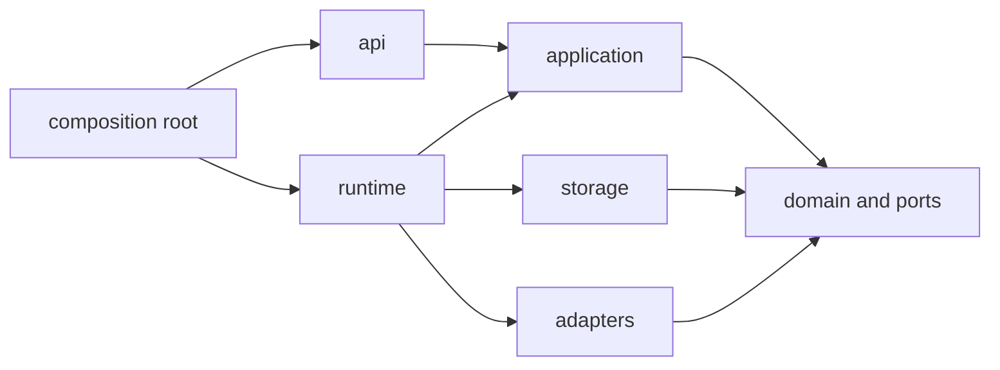

# Agent 层架构基调（不变量）

> 2026-10-19。这是 Agent 层的**基调**：后续所有改动都受这些约束。违反其中一条即视为架构退化，而不是"实现细节"。
> 每条给出：为什么、现状（原型对应位置）、怎么检查。阶段顺序见[实施路线](roadmap.md)。

## 一、十条不变量

### 1. 唯一事实来源
会话历史、任务进度、产品状态只存在于 Durable 的 entries / tasks / documents。**不得**另存一份 `messages[]`、第二套任务队列或旁路数据库。客户端缓存只能用于展示，必须能从服务端重建。

- 现状：符合。`service.mjs` 直接使用 `harness.conversation()`、`defineTask`、`defineDoc`，没有自有消息数组。
- 检查：`grep -rn "messages\s*=\s*\[" apps/server/src` 应为空；任何新表/文件存储先回答"能否用 document/task 表达"。

### 2. 业务状态与运行进度分离
产品任务（用户看到的"这件事"）与运行任务（Agent 执行的一次尝试）是两个身份，用稳定 ID 关联，不合并。

- 现状：符合。产品 `job` 在 State 文档里，执行是 Durable task；`jobId` 与 task/conversation ID 互相引用。
- 检查：恢复同一次尝试沿用 attemptId；重跑或新修订创建新的 attemptId，取消不创建尝试。`revision` 必须参与提交校验。旧原型对这组身份的完整对应仍需 WP1b 审计。

### 3. 副作用三态：done / unknown / failed
凡是离开进程的动作（发消息、提交表单、写外部系统、调用付费模型、通知渠道）都必须先记录意图，再执行，结果落盘。**中断后的 `unknown` 只能通过观察核销，禁止自动重放。**

- 现状：投递与浏览器已有实验覆盖，但付费模型、任意外部工具并未因此全部得到保证，仍需 WP7 审计。投递 intent-before-effect（`service.mjs:419-462`）、浏览器动作 `unknown/reconcile`（`browser.mjs:143-171`）、`stale snapshot` 拒绝。
- 检查：新增任何外部调用，必须有 `attempting → acked | unknown` 记录与对应测试；不得直接 `await fetch(...)` 后就当作成功。

### 4. 幂等键 + 明确事务边界
每个写操作都要有幂等键；同一业务结果的多条记录必须在**同一个 commit** 内落盘，不能分成多次写。

- 现状：部分符合。chat/job/share/memory 有 `requestKey`；但 `cancel`、`stop`、`compact`、`update` 没有（[A3](roadmap.md) 待补）。
- 现状：原子组正确——结果 entry + 任务完成 + Report task + notification + followup 在一个 `runtime.commit`（`service.mjs:467-483`）。
- 检查：契约测试要求"重放响应逐字节相等"；新增写路径必须在 PR/提交里标出事务边界。

### 5. 会话身份稳定，fork 只在完整边界
main 与侧聊身份跨重启稳定；fork 只能从完整消息边界切分，不能复制未完成的工具调用。

- 现状：符合。`forkPoint` 只取完整模型边界（`conversations.mjs:47-58`），有测试覆盖。
- 检查：任何"从某条消息继续"的功能都复用 `forkPoint`，禁止按索引硬切。

### 6. 上下文：压缩不改变事实
活动上下文可以被压缩、裁剪、重排；**原始历史不得被删除或改写**。模型看到的是投影，不是事实来源。

- 现状：符合（Durable 原生压缩 + 手动 `/compact`，历史可继续分页）。
- 检查：压缩相关测试必须断言"原记录仍可读取"；任何"清理历史"的操作需要单独 ADR。

### 7. 记忆：显式、可溯源、可遗忘
只保存用户明确要求保存的内容；每条带来源会话与时间；遗忘删除保存条目但不改写历史；**不做自动知识抽取**（除非有独立 ADR 与评测）。

- 现状：符合。最多 64 条、带来源、`/remember`、`/forget`，历史仍保留。
- 检查：新增"自动记忆"必须同时提供可见、可纠正、可删除三个入口。

### 8. 资源 = 租约 + 适配器
浏览器、文件、网络等任何外部资源，在 Agent 层都表现为 `resource{id, owner, lease, controlEpoch, state}`；**domain 不得 import 具体实现**（Steel / CDP / puppeteer / RTC）。

- 现状：**部分符合，是本次调整的重点**。`service.mjs` 直接 import `createBrowserExtension`，domain 与实现耦合；浏览器动作语义已经正确（owner/lease/unknown），但接口没抽出来。
- 检查：`grep -rn "steel\|cdp\|puppeteer\|rtc" apps/server/src/domain` 应为空；同一接口能用内存桩跑通租约与 unknown 用例。
- 为什么重要：浏览器推迟集成的前提是这条现在做对，否则以后接原生 RTC 要改任务状态机与恢复流程。

### 9. 单写者 + 数据目录固定 + 备份前置
同一数据目录只允许一个写入进程；数据目录布局一次定死；任何升级/迁移前必须先产出可恢复快照。

- 现状：符合。`owner.sqlite` 的 `BEGIN EXCLUSIVE` 锁（`service.mjs:24-29`），SIGKILL 由 OS 释放；备份脚本已入库。
- 检查：升级路径必须"先备份、写 meta、再迁移"；恢复演练随备份脚本一起维护。

### 10. 演化：锁版本、固定回归、不并行第二引擎
Agent 层依赖锁定精确版本（当前 pi-durable / pi-ai / chord `1.3.0`），升级前跑固定回归子集与迁移演练；**不引入第二套执行引擎**（Pi coding-agent SDK、DSH 等）。

- 现状：符合。`package.json` 精确版本；ADR-001 记录两次反转。
- 检查：依赖升级必须单独提交并附回归结果；`package.json` 不出现 `^`/`~`。

## 二、完成定义（DoD）

任何改动，满足以下全部才算完成：

1. **状态变更**：有对应的崩溃注入用例（在 7 个故障窗口模型上扩展）。
2. **写操作**：有幂等键，且重放测试通过。
3. **外部副作用**：有 `done/unknown/failed` 三态用例，`unknown` 不会被自动重放。
4. **状态字段**：有迁移路径或明确"仅内存"。
5. **接口变更**：`docs/design` 里对应文档同步，`verification-status` 数字更新。
6. **perf 敏感路径**（snapshot/SSE）：有夹具数据规模下的耗时断言。

## 三、边界图

**允许依赖**：api → application/domain；application → domain；runtime → application/domain/storage/adapters；storage/adapters → application/domain；组合根组装具体实现。domain 与 application 不依赖平台/SDK，domain 不定义 Durable task。AG-UI 只在 api。实际约束由根目录 `npm run check` 检查。长期职责见 [Server 架构](server-architecture.md)。

## 四、验收清单：什么算"Agent 层坐稳了"

- [ ] Muse 产品场景与 Point 已确认行为在正式 Server 独立验收；旧原型套件只作回归，不以复制测试数量代替体验验收。见 [对话体验](conversation-experience.md)。
- [ ] 任务状态转移表 100% 覆盖，非法转移被拒绝。
- [ ] 四类副作用（通知/文件/浏览器/未来外部系统）都有 `unknown` 用例。
- [ ] v1→v2 状态迁移有单向可验证路径 + 恢复快照回滚演练。
- [ ] API `/v1` 契约测试覆盖错误码矩阵与重放幂等。
- [ ] 客户端断线重连能仅凭事件 + 快照重建视图。
- [ ] 容器化后重启不丢状态、不丢计划、不丢待投递结果。
- [ ] 7 天挂机无泄漏、无陈旧通知，成本可查。
- [ ] 依赖升级流程演练过一次（锁版本 → 回归 → 迁移检查）。

满足后可在稳定资源边界内实施浏览器接入；具体适配仍需控制权、恢复与绕过路径验收，不能保证无需任何契约演进。
