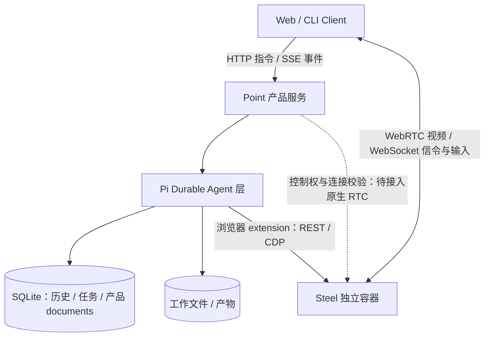

# 产品与 Server / Client 架构

> 已定方向，2026-10-18：Point 产品层 + Pi Durable Agent 层 + Steel 浏览器基础设施。完整产品尚未实现。

## 产品形态

Point 是一个人的持续工作伙伴，参考 Muse 的主对话、主题侧聊、后台工作、工具执行、浏览器与产物形态。它能在用户离开后继续推进已交代的工作，并在需要时回到对应会话。

单用户是长期边界。多个客户端共享同一人的状态；Server 的远程访问需验证本人身份，采用单用户访问令牌（WP4 实现），不建设注册、租户或角色系统。

长期实现边界、身份与事务设计见 [Server 架构](server-architecture.md)；选型依据与取舍见 [ADR-002](adr/ADR-002-server-foundation.md)。

## 三层职责

| 组件 | 负责 | 集成边界 |
|---|---|---|
| Point | main/侧聊关系、产品任务与目标、记忆、计划语义、判断、结果路由、通知、浏览器归属与控制权 | 通过 Durable extension / task / document 实现；不另写模型—工具循环 |
| Pi Durable | 模型请求与工具循环、上下文组装与压缩、工具任务、会话历史、checkpoint、持久调度与恢复 | 使用真实持久存储和稳定 ID；不替 Point 决定任务完成、记什么或何时通知 |
| Steel | Chromium、浏览器 session、CDP 接入、画面采集与 RTC 服务 | 通过 REST/CDP 适配；会话租约、业务动作核对和人机互斥由 Point 集成保证 |
| Client | 对话、任务与产物展示，浏览器观看/接手、状态控制 | 不承担定时任务或后台执行；重连从服务端快照和历史恢复 |

Pi Durable 内部使用 pi-ai 访问模型。Point 不并行运行 Pi coding-agent SDK；扩展、skills、MCP 等资源需要按 Durable 能力显式接入，不能假定终端插件可直接加载。

## 会话与后台工作

- **main**：长期保留的主会话。稳定身份不意味着无限历史全部送进模型，活动上下文由 Durable 管理。
- **主题侧聊**：同一个助手的独立话题，可新建或从完整消息边界 fork，长期保留、归档后可恢复。
- **执行会话**：后台任务的内部上下文，按任务创建，承载模型与工具工作，恢复沿用原身份。
- **结果回传**：任务结果先保存，再送回所属会话；是否同时给 main 摘要按委派来源和用户要求决定。
- **主题同步**：显式整理已确认结论、产物和未解决事项送给 main，不合并所有消息，也不自动变成长期记忆。

详细语义见[会话与跟进](conversation-and-followup.md)、[任务与 Agent](tasks-and-agents.md)。

## 部署与状态权威

目标部署为 Point Server 与 Steel 两个独立服务。Point Server 内嵌 Durable；Web 可由 Server 托管或独立部署。Docker/supervisor 负责拉起进程，Durable 负责重开存储后恢复工作。服务停止期间不执行模型或定时动作。

| 状态 | 唯一权威 | 持久化与恢复要求 |
|---|---|---|
| 会话原始历史、活动上下文、运行时 Task 与 checkpoint | Durable storage | 初版 SQLite；同一数据目录只允许一个活跃 Server 写入 |
| 聊天目录、产品任务/目标/计划、记忆元数据、回传与投递记录、浏览器租约 | Point 定义的 Durable documents | 与任务创建/结果提交尽量同事务；客户端缓存仅作展示 |
| 文件与产物 | Point 工作目录与产物目录 | 独立卷，元数据引用；文件写入不属于 SQLite 事务，需原子写/核对 |
| 活动浏览器、页面与网站当前登录状态 | Steel / Chromium | 重连后观察；会话失效不能当作页面原样恢复 |
| 保存的命名登录配置 | Point 受限文件，document 保存引用 | 初版 cookies/localStorage 检查点，不等同完整 profile；不进入模型记忆 |
| 模型/服务凭据 | 部署密钥或受限配置 | 不写入聊天、记忆、镜像或公开状态 |

产品任务引用 Durable task/conversation ID，二者分别表达业务状态与运行进度，不为同一执行再建一套独立队列。读取视图可重建，不能成为第二份事实来源。初版不设计分布式多写集群；数据库与文件的备份/恢复一致性在正式部署前验收。

Steel 默认使用[国内固定 digest 镜像](browser-infrastructure.md)。Agent 执行命令、读写文件、联网和工具调用在 Server 环境内进行；不默认挂载或控制个人电脑。浏览器独立容器不自动为 Agent 命令提供沙箱。

## 浏览器与接管

浏览器任务可使用专门的 Agent 配置，仍运行于同一个 Durable 引擎。浏览器句柄归属具体聊天或执行会话；新建/fork/切换聊天不继承活动句柄。初版适配器容量为 1，多任务需明确排队或返回忙碌，不能抢占未知 session。

Web 默认观看，接手后阻止相应 Agent 输入，交还后重新观察再继续。接管影响对应浏览器资源，其他独立任务可继续。所有输入路径都必须检查控制权，不能仅依靠提示词或页面上的按钮禁用。

视频目标采用已打包 Steel 的原生 WebRTC；该镜像的信令和人工输入仍是 WebSocket。原生播放器尚未纳入 Point 接管互斥，是正式集成前的必做项；此前 Python RTC 桥仅保留为验证/回归路径。详见[浏览器基础设施](browser-infrastructure.md)。

## Web 产品范围

| 视图 | 职责 |
|---|---|
| 对话 | main 与主题侧聊，交代任务、追问、同步结论与查看结果 |
| 任务 | 执行中、等待用户、已安排、已结束的工作，停止、补充与继续 |
| 工作区 | 查看、下载文件和产物 |
| 浏览器 | 实时观看，接手登录/操作并交还控制 |

布局倾向主对话常驻，任务详情、文件和浏览器在侧边展开。记忆管理与详细决策审计界面后置，后台记录不能省略。

Client 到 Server 的初版方向沿用原型 HTTP + SSE，浏览器媒体单独连接 Steel。流式协议采用 [AG-UI 边缘投影](protocol-agui.md)，自定义续传绑定与鉴权仍待实现；SSE 不提供网页关闭后的系统推送。

## 参考与实施状态

Muse 用来参考产品体验，Point 的 main/侧聊关系与恢复协议是自己的设计，不声称复刻 Muse 内部实现。证据见[会话调研](../research/muse-conversation-design-2026-10-18.md)。

已验证实现位于[Durable 原型](../../infra/pi-durable-validation/README.md)。`server/` 是旧 SDK 验证工程；本次设计决定不代表已经完成目录迁移、Docker 化或原生 RTC 控制集成。迁移顺序见[运行时选型](runtime-selection.md)。
