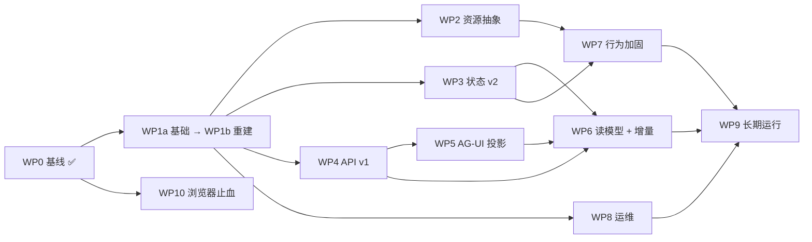

# 实施路线（工作包制，不排时间）

> 2026-10-19 修订（第三版）：**不按周排期**。这个项目由人类与 agent 协作推进，进度用"工作包 + 闸门"衡量，而不是日历。
> 约束见 [Agent 层架构基调](agent-core.md)；客户端协议见 [AG-UI 评估](protocol-agui.md)；证据口径见[验证状态](verification-status.md)。

## 当前交付与长期方向

**2026-10-19 最新决定**：WP1a 基础骨架已交付。用户指出原型在稳定性和扩展性上不足，要求 WP1b 从工程角度重建；此前“直接迁移、保留全部实现行为”的执行方式被本决定取代。

WP1b 以产品行为契约和失败语义为出口，原型只提供案例与可行性证据。旧离线套件继续作为原型回归，不要求机械复制测试数量，也不把原型偶然行为当作产品要求。正式实现独立测试，每片同时验证持久化、幂等与恢复。实际完成状态见 [验证状态](verification-status.md)，执行明细见 [核心重建计划](agent-core-rebuild.md)。

架构以 [server-architecture](server-architecture.md) 和 [ADR-002](adr/ADR-002-server-foundation.md) 为准。WP1a 的 root 构建、CI、文档与应用代码由一个 owner 串行修改；不启动团队流程提案，不占用浏览器 lane。

## 0. 推进方式

- **工作单元 = 工作包（WP）**：一个 WP 是一个可独立验收、可独立回滚的改动，对应一个分支/PR、一个 owner（人或 agent）。
- **进度 = 闸门（G）**：过闸门才进入下一批工作。没有"第几周完成"这种东西，只有"依赖是否满足、判据是否通过"。
- **并行 = 文件所有权互斥**：同一 lane 内串行，candidate lane 之间可以并行，前提是接口先冻结、写文件不重叠。
- **人类负责判断，agent 负责实现**：见 §5 的协作协议。

## 1. "坐稳 Agent" 的定义

四类契约可验证，而不是功能多：

| 契约 | 内容 | 当前状态 |
|---|---|---|
| 状态 | 会话/任务/记忆/事件的唯一权威、版本与迁移 | 单文档 v1 + `??=` 补丁；无迁移框架；事件环形截断 |
| 执行 | 任务生命周期、幂等、崩溃恢复、副作用三态 | 原型有 70 次强杀证据，但绑定在验证工程里 |
| 接口 | 稳定 ID、`/v1`、错误码、事件游标与重连、客户端协议 | 无版本；SSE 每次全量；错误只有字符串 |
| 运营 | 单写者、常驻、日志、指标、备份、成本 | 单写者可靠；其余为零 |

## 2. 工作包清单

依赖标注：`→` 表示必须在前一个完成后开始；`∥` 表示可并行。

| WP | 内容 | 依赖 | 出口判据（可运行） | 修改范围 |
|---|---|---|---|---|
| **WP0** ✅ | 基线：仓库、证据入库、备份脚本、CI、凭据 | — | 全新克隆 `npm ci && check && test` 全绿 | 已完成 |
| **WP1a** | 长期架构、模块边界、TypeScript Server 基础生命周期、独立测试 | WP0 | 根目录 `npm ci --ignore-scripts && npm run check && npm test`；真实 Durable 初始化/锁/关闭/版本拒绝；原型规定回归仍绿 | `apps/server/**`、根构建/CI、设计/OpenSpec、新增证据（串行） |
| **WP1b** | 正式 Agent 核心工程化重建：命令、消息/上下文、执行、计划与投递，按独立分片推进 | WP1a | 逐条产品契约及失败矩阵独立通过；domain 无 defineTask；无原型源码/测试钩子依赖；每片持久写入即验收恢复 | `apps/server/**`、设计/OpenSpec/证据，串行；旧库迁移另交 WP3 |
| **WP2** | 资源抽象：`resource{owner,lease,controlEpoch,state}` 接口 + `adapters/resource`；文件/通知/浏览器统一"意图→执行→三态"；domain 不 import 具体实现 | WP1 | 同一接口能用内存桩跑通租约、过期、`unknown`；`grep` 证明 domain 无 steel/cdp | `apps/server/src/adapters/**`、`domain/**` |
| **WP3** | 状态 v2 + 迁移：`point.meta/chats/chat/memory/job/jobs/browser/requests` 分片；事件改时间线；单 commit 迁移；升级前自动备份；版本闸门 | WP1（与 WP4 可并行，但**事务组唯一 owner**） | v1 夹具库升级语义等值；重启两次迁移幂等；恢复 pre-v2 快照可启动；请求账本有清扫 | `apps/server/src/storage/**`、`runtime/**` |
| **WP4** | API v1 基础契约：`/v1`、错误码对象、所有写操作幂等键、`/inspect` 门控、鉴权、访问日志 | WP1 | 契约测试覆盖 400/404/409/413/503；重放响应逐字节相等 | `apps/server/src/api/**` |
| **WP5** | AG-UI 投影：`POST /v1/agent`、run 生命周期、文本/工具/step 事件、`RUN_FINISHED.usage`、cancelled 语义 | WP4 | 契约测试：流以 `RUN_STARTED` 开头；未知事件被容忍；截断流不伪造 FINISHED；CLI 作为第一个消费者 | `apps/server/src/api/agui/**` |
| **WP6** | 读模型 + 增量事件：`subscribeCommits` 投影；`STATE_SNAPSHOT/DELTA`、`MESSAGES_SNAPSHOT`、`ACTIVITY`、`CUSTOM`；线程流（自定义绑定 + `Last-Event-ID` + 同步 run）；运行流 | WP3、WP4、WP5 | 100 job/10 chat 夹具下 `/state` 的 `storage.task` 调用=0；单 commit 只发 O(变更) 帧；离线重连后状态/消息一致 | `apps/server/src/api/**`、`storage/**` |
| **WP7** | Agent 行为加固：任务状态转移表（含非法转移）、artifact/deliver 的 revision 复检、上下文/压缩边界、记忆上限与遗忘、投递 `unknown` 核销、成本记录 | WP1、WP2（部分依赖 WP3） | 状态转移表 100% 覆盖；每类副作用都有 `unknown` 用例；一次任务可从事件重建 | `apps/server/src/domain/**`、`adapters/**` |
| **WP8** | 常驻化与运维：Dockerfile + compose（restart/healthcheck/资源限制/卷/TZ/非 root）、日志保留、定时备份、指标（任务数/失败率/延迟/费用） | WP1 | 容器重启状态与计划无损；恢复演练通过；一次任务全链路可追溯 | `apps/server/Dockerfile`、`deploy/**`、`infra/**` |
| **WP9** | 长期运行：7 天挂机、供应商故障退避、周期计划最小版、判断层最小规则、成本预算与告警 | WP6、WP7、WP8 | 7 天无泄漏/无丢计划/无陈旧通知；人为注入超时与限流可恢复 | `apps/server/**`、`docs/design/**` |
| **WP10** | 浏览器止血（**冻结，不集成**）：Steel P1 补丁（WS 写串行化）、端口收敛、compose `restart`、文档标注；代码只修 bug | WP0 | 并发 12+ 连接不再 panic；崩溃回归用例通过；测试仍绿 | `infra/pi-durable-validation/**`（最小） |

## 3. 依赖图与并行轨道

四条可并行 lane（文件不重叠）：

| Lane | 工作包 | 拥有的文件 | 约束 |
|---|---|---|---|
| **A 状态与读模型** | WP3 → WP6 | `storage/**`、`api/**` 的事件投影部分 | **schema/事务组唯一 owner**，其他 lane 不得改 |
| **B 接口与协议** | WP4 → WP5 | `api/http/**`、`api/agui/**` | 只读 A 的存储接口，不改 schema |
| **C 领域行为** | WP2 → WP7 | `domain/**`、`application/**`、`adapters/**` | 依赖 B 的契约草案，不改 api |
| **D 运维与止血** | WP8、WP10 | `Dockerfile`、`deploy/**`、`infra/**` | 不改应用逻辑 |

**闸门**：

- **G1 骨架就绪**：WP1a + WP1b + WP2。`domain` 与具体实现解耦，资源接口可用桩验证。
- **G2 契约就绪**：WP4 + WP5。REST 与 AG-UI 的契约测试通过，CLI 已切到新协议。
- **G3 状态就绪**：WP3 + WP6。迁移可回滚，增量事件与重连同步通过。
- **G4 行为与运营就绪**：WP7 + WP8。状态转移表、`unknown` 用例、容器重启、备份恢复全部通过。
- **G5 运行基线通过**：WP9。完成约定长跑与故障注入，得到该环境下的运行证据；不等于完整产品、任意任务或永久可靠。

## 4. 串行规则（违反就会返工）

1. **状态 schema 与事务组**：WP1b 的新增分片 schema 由当前唯一 owner 串行设计并验收；WP3 负责旧库迁移与升级框架，WP6 随后推进，其他 lane 不并发改 schema。
2. **接口冻结点**：WP1b 的 ports 验收完成 → 各 lane 才能并行；WP2 的资源接口 → adapter 才能写；WP4 的 API 形状 → WP5 才能写；WP5 的事件形状 → Web 才能接。
3. **一个 WP = 一个分支/PR**：迁移提交必须独立，不夹带功能改动。
4. **契约变更需 owner 批准**：改测试断言等于改契约，必须由对应 lane owner 确认。
5. **副作用三态与资源租约先于所有 adapter**：否则每加一个外部能力都要改 domain。
6. **备份/恢复演练早于真实数据**；**日志/指标早于长跑**。
7. **浏览器在 P1 补丁前不开放入口**；浏览器集成（原 M3）不在本路线内，等 G5 后重新评估。

## 5. 人类与 Agent 的协作协议

### 5.1 角色

| 角色 | 负责 |
|---|---|
| **人类** | 定基调、过闸门、做取舍（如 A/B/C 决策）、真实验收（真实模型/真实浏览器/体感）、掌管凭据与发布 |
| **Agent** | 实现 WP、写测试、更新文档、跑判据、报告证据；不自行改契约、不自行扩范围 |
| **Lead（可为人或 agent）** | 拆分 WP、并行分派、审查 diff、合并、跑全局回归 |

### 5.2 每个 WP 的交接格式

开始前（Ready）必须写清：范围（文件）、依赖、验收命令、动的契约、文档更新点、回滚方式。
完成后（Done）必须满足：

1. 验收命令通过，输出附在 PR/提交说明里；
2. 新增/修改的测试可独立运行；
3. 相关文档同步（`docs/design/**`、`verification-status`）；
4. 没有跨 lane 的文件改动；
5. 明确写出"未验证项"。

### 5.3 并行分派规则

- 一个 agent 一次只持有一个 WP；同一 lane 不并行。
- 分派时给出：WP 编号、允许写的前缀、禁止写的目录、验收命令。
- 冲突检测靠写前缀互斥；一旦要动别人 lane 的文件，先升级为串行或换 owner。
- 合并顺序按依赖图，不按完成时间。
- 每个闸门由 Lead 跑一次全局回归 + 人工抽查，再宣布通过。

### 5.4 决策与记录

- 架构取舍写成 ADR（`docs/design/adr/`），不留在聊天里。
- 未定问题开 issue，不阻塞 lane 的其它部分。
- 证据数字只写进 [verification-status](verification-status.md)，其它地方引用它。

## 6. 风险与决策点

| 风险 | 证据 | 处理 |
|---|---|---|
| 状态重构期间语义漂移 | 单文档 + 隐式 `??=` | WP3 以"v1 夹具库语义等值"为硬判据 |
| 长跑状态膨胀 / 事件成本 | 单文档、无清理、O(jobs) | WP3 + WP6；WP9 先压测 |
| AG-UI 规范演进 | 1.0 已有 31 事件且仍在加 | 锁 `protocolVersion`，vendored schema 契约测试，未知事件容忍 |
| 判断层无证据 | [decision-layer](decision-layer.md) 自述未验证 | WP9 只做可审计的最小规则，不做黑盒评分 |
| pi-durable 实验性 API | 1.3.0 锁定、无兼容承诺 | 升级前跑固定回归 + 迁移演练；每季度评估 |
| 成本不可见 | 无 token/费用记录 | WP5 `usage` + WP7 记录 + WP8 指标 |
| Steel 崩溃/暴露面 | 已实测未鉴权并发打挂容器 | WP10 止血；正式集成另行评估 |

## 7. 反模式

1. 把原型源码搬进正式目录当作重建完成；或以旧测试数量代替产品契约及故障验收。
2. 浏览器推迟但资源抽象写成"浏览器专用"。
3. 先做 UI 再定契约。
4. 迁移与功能混在一个 PR。
5. 跳过备份/恢复就跑长任务。
6. 引入第二执行引擎。
7. 用"第几周"衡量进度——只看闸门。
8. agent 自行扩大范围或修改契约测试。

## 8. 长期产品路线（不止一个阶段）

以下是后续候选 WP，不因写进路线即视为已授权实现。每个开始前补齐 Ready 和契约；依赖表中的 WP1 均指 WP1a+WP1b。已实施的真实测试数字只引用验证状态。

| WP | 产品结果 | 前置 | 验收重点与范围 |
|---|---|---|---|
| WP11 承诺闭环 | 对话发现明确承诺、纠正/完成、时间解释、提前准备草稿、最多规定次数跟进 | G3、WP7、WP9 | 模糊意愿不建任务，无日期不催促，错过提醒合并，修订不发旧提醒；domain/application/runtime，语义评测与 Durable 故障测试 |
| WP12 长期目标 | 目标→计划→有界工作→结果核验→下一步；暂停/恢复与计划修订 | WP11、预算/决策审计 | 用户目标不被 task settled 自动完成；等待用户持久化；无进展/预算耗尽停止；跨重启/多次 attempt 仍可解释 |
| WP13 首个 Web 客户端 | 主会话、侧聊、工作与产物，离线后可重建 | G2、G3、WP7 | 先 CLI 契约消费，再 apps/web；真实断线重连、停止/取消作用域、错误可见；不搬服务端事实到浏览器 |
| WP14 浏览器正式集成 | Steel 工作环境与人工接管 | G4、WP10、WP2、WP13 | 单一资源控制入口；旧 epoch 拒绝；unknown 核销；重启资源对账；发布镜像实测；此前保持冻结 |
| WP15 个性化与上下文质量 | 显式 Profile/USER.md 导入导出、来源、遗忘、上下文预算与纠错 | G3、WP7 | 没有第二权威；保存/导入/删除幂等；压缩不删历史；相关性/误记回归。自动记忆需新 ADR |
| WP16 单向通知 | 至少一个可用渠道，结果在会话完整保留 | WP11、WP7、WP8 | decision 与 delivery 分离；陈旧消息丢弃；回执丢失 unknown；通知失败不丢对话结果 |
| WP17 外部数据源与扩展 | 按需接邮箱/其他平台、MCP/skills | G4、WP12、WP15 | 来源可追溯、权限/幂等/撤销、资源与预算；无新队列/引擎；不默认把通知邮箱当数据源 |
| WP18 个人长期使用验收 | Docker 部署、恢复、升级、导出与持续使用闭环 | G5、WP11–WP16 中实际启用部分 | 原型能力之外，真实用户从交代到完成/纠正的体验、成本、恢复演练与依赖升级；范围清单明确后再给版本标签 |

**产品闸门**：P1（会话/工作/主动跟进闭环）= WP11 + WP13 + WP16；P2（长期目标与环境）= WP12 + WP14 + WP15；P3（可长期自托管）= WP18。WP17 按具体需要增加，不阻塞无外部数据源的自用版本。没有自动把 G5 对应为 v1.0 的规则。

## 9. 每个工作包的落地顺序

先核查锁定 Durable SDK 的公开能力与实现，记录复用项和确实缺少的产品契约；再固定用户行为案例与失败语义，再写领域规则和 ports，再实现 Durable 事务与 task，最后实现 adapter/API/客户端。新增持久状态前设计迁移，新增外部动作前写 unknown 用例。针对每个交付，回答：谁是权威、谁持有事务、如何去重、取消/修订后如何拒绝旧结果、重启时如何恢复、如何证明用户目标完成。

不先搭建通用插件市场、自动多 Agent 团队或分布式平台。只有真实用例需要的抽象进入工程；后续改变外部能力时通过 resource/delivery/context 边界扩展，而不是修改 Durable 内核。
