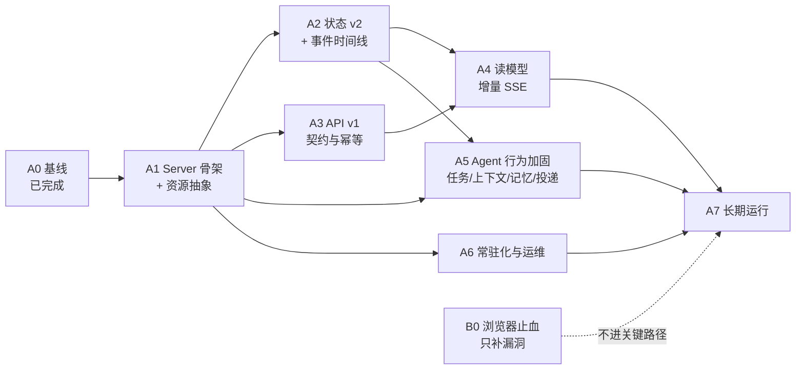

# 实施路线（Agent 优先）

> 2026-10-19 修订。前一版把浏览器原生 RTC 放在并行轨道；本版按产品判断调整为：**先坐稳 Agent 层，浏览器暂缓**。
> 基调与不变量见 [Agent 层架构基调](agent-core.md)；证据口径见[验证状态](verification-status.md)。

## 0. 为什么可以暂缓浏览器，以及暂缓的前提

**可以暂缓**：浏览器是外部依赖、能力可替换（Python 桥已验证接管互斥，原生媒体只是更优的实现路径），它不决定 Agent 的状态权威、任务语义或恢复契约。推迟它不会让 Agent 层停工。

**但有一个前提**：现在必须把**外部资源抽象成"租约 + 适配器"**，让 Agent domain 只认识 `resource{owner, lease, controlEpoch, state}`，不认识 Steel/RTC/CDP。否则将来接原生 RTC 时，任务状态机、恢复流程、事件模型都要跟着改——**推迟就变成了延后返工**。

暂缓期间只做两件事，不做集成：
1. **止血**：Steel 容器的崩溃与暴露面（见 §6）。
2. **抽象**：资源租约接口 + adapter 边界（属于 A1/A2 的工作包）。

## 1. "坐稳 Agent" 的定义

不是把功能做大，而是让四类契约在 Agent 层可验证：

| 契约 | 内容 | 现状 |
|---|---|---|
| **状态** | 会话/任务/记忆/事件的唯一权威、版本与迁移 | 单文档 v1 + `??=` 补丁；无迁移框架；事件环形截断 |
| **执行** | 任务生命周期、幂等、崩溃恢复、副作用三态 | 原型已有 70 次强杀证据，但绑定在验证工程里 |
| **接口** | 稳定 ID、`/v1`、错误码、SSE 游标与重连 | 无版本；SSE 每次全量；错误只有字符串 |
| **运营** | 单写者、常驻、日志、指标、备份、成本 | 单写者可靠；其余为零 |

**完成标准**：一个任务从创建到结果回传，能在进程被强杀、依赖超时、模型答错、客户端断线四种情况下都被解释和恢复，且每个状态变更都有对应测试。

## 2. 路线图

关键路径：**A1 → A2 → A4 → A7**。A3、A5、A6 可并行；B0 是独立小任务。

## 3. 阶段、工作包与出口判据

### A0 基线（已完成 2026-10-19）
仓库、`baseline` tag、证据入库、备份脚本 + 恢复演练、CI、凭据入环境变量。

### A1 Server 骨架 + 资源抽象（1.5–2 周，串行前置）
只搬不改语义，同时把"外部资源"抽象定死。

工作包：
- 目录 `apps/server/src/{api,domain,runtime,adapters,storage}`；`service.mjs`（781 行）拆成组合根 + `domain/tasks/{work,report,share,followup}` + `domain/{jobs,chats,memory}` + `runtime/{bootstrap,extensions}`。
- **资源租约接口**（新增，关键）：`adapters/resource.mjs` 定义 `acquire/release/observe/control{epoch,scope}/expire`；浏览器成为第一个实现，Agent domain 不 import Steel/CDP。
- **副作用通道**：文件、通知、浏览器动作统一走"执行记录 → 结果 → `done/unknown/failed`"，`unknown` 必须可观察核销、禁止自动重放。
- 配置与凭据收敛（`POINT_*`）、数据目录布局固定、结构化日志骨架。

**出口判据**：
- 28 项离线套件在新结构全绿；`npm run check` 全绿。
- `test/unit/*` 不 spawn 服务、不写 `runtime/`。
- `grep -rn "defineTask" apps/server/src/domain` 为空；`grep -rn "steel\|cdp\|puppeteer" apps/server/src/domain` 为空。
- 同一个资源接口既能驱动现有浏览器，也能用内存桩验证租约与 unknown 语义。

### A2 状态 v2 + 事件时间线（1.5 周，串行，单一 owner）
问题：单文档热点、`jobs/requests/actions` 无界、`events` 环形截断 200 导致断线丢事件、`snapshot` 对每 job 调 `storage.task`。

工作包：`point.meta`（schemaVersion/migratedFrom/backupRef）+ 分片 `point.chats/point.chat/point.memory/point.job/point.jobs/point.browser/point.requests`；事件改 `appendEntry` 时间线，游标 = commit seq；迁移在 `harness.resume()` 前用**单个 root commit** 完成；版本高于支持则拒绝启动；升级前自动备份并记 sha256。

**出口判据**：v1 夹具库升级后 `/jobs`、`/chats`、`/memory` 语义等值；连续重启 2 次 `migratedAt` 不变；恢复 pre-v2 备份可启动；`point.requests` 有清扫策略与测试。

### A3 API v1 契约（1–1.5 周，可与 A2 并行）
`/v1` 前缀；`{error:{code,message,requestId,retryable}}`；所有写操作补幂等键（`cancel/stop/compact/update` 当前缺失）；`/inspect` 门控；`POST /jobs` 重放响应形状统一；SSE `id:` + `Last-Event-ID`。

**出口判据**：契约测试覆盖 400/404/409/413/503；重放响应逐字节相等；SSE 帧单调 id 且可补发。

### A4 读模型 + 增量 SSE（1.5–2 周，依赖 A2+A3）
用 `subscribeCommits` 的 `{seq, changes}` 投影取代全量快照。

**出口判据**：100 job / 10 chat 夹具下 `/state` 的 `storage.task` 调用 = 0；单 commit 只发 O(变更) 帧；重连回放与首连序列 deepEqual；`/state` p95 < 50ms。

### A5 Agent 行为加固（2–3 周，依赖 A1；部分可与 A2/A4 并行）
这是"坐稳"的核心：把产品语义从"能跑"变成"可解释、可测试"。

工作包：
- **任务语义**：Work/Report/Share/Followup 的状态转移表 + 非法转移拒绝；artifact 与 deliver 阶段补 `revision` 复检（现有缺口，`service.mjs:405-415`）；取消/改期/归档的路由规则用表驱动测试。
- **上下文与记忆**：压缩只作用于活动上下文、原始历史可分页（已有测试，补齐边界：压缩期间强杀、记忆上限、遗忘后历史仍可读）。
- **投递与通知**：intent-before-effect、回执校验、`unknown` 人工核销路径（目前只有语义，无界面）。
- **错误分类**：模型错误 / 工具错误 / 外部依赖错误 / 客户端断线分开建模，禁止"模型自信回答把工具失败变成功"（已有用例，扩展到所有 task 类型）。
- **成本**：每次模型调用记录 tokens/耗时/费用，任务维度汇总，设上限与告警。

**出口判据**：
- 任务状态转移表 100% 覆盖（含非法转移）；
- 每类副作用都有 `unknown` 用例；
- 上下文/记忆/成本三份契约测试在 `test/unit` 与 `test/integration` 都过；
- 一次任务可从日志/事件重建完整时间线。

### A6 常驻化与运维（1–1.5 周，A1 后可并行）
Server Dockerfile + compose（`restart: unless-stopped`、healthcheck、资源限制、数据卷、TZ、非 root）；日志落 stdout + 保留策略；定时备份；指标（任务数/失败率/延迟/费用）；凭据 secret。

**出口判据**：容器重启状态与计划无损；备份恢复演练通过；`down && up` 后 `/v1/health` 与历史可读；一次任务全链路可追溯。

### A7 长期运行（2–4 周，依赖 A4+A5+A6）
7 天挂机（内存/句柄/SSE 连接/任务积压）、供应商故障退避、周期计划（最小版）、记忆规模、成本曲线。

**出口判据**：7 天不重启无泄漏、无丢失计划、无陈旧通知；人为注入模型超时/限流/网络错误仍可恢复；每新增状态变更都有强杀用例。

## 4. 并行 / 串行矩阵（Agent 侧）

| 工作 | 依赖 | 可并行于 | 说明 |
|---|---|---|---|
| A1 骨架 + 资源抽象 | A0 | — | 前置；先冻结 ports/接口 1 天再分派 |
| A2 状态 v2 | A1 | A3、A6 | 事务组单一 owner，**不可与其他改事务组的工作并行** |
| A3 API v1 | A1 | A2、A5（部分）、A6 | 只动 api 层 |
| A4 读模型/SSE | A2、A3 | A5、A6 | 与 A2 都碰事务组，必须排在 A2 之后 |
| A5 行为加固 | A1（+A2） | A3、A4、A6 | 先做任务语义与副作用，上下文/成本可后置 |
| A6 运维 | A1 | A2、A3、A4、A5 | 数据目录布局一冻结就能容器化 |
| A7 长跑 | A4、A5、A6 | — | 必须在日志/指标/备份之后 |

**五条硬串行规则**：
1. 状态 schema 变更串行、单一 owner（A2→A4）。
2. 数据目录布局冻结在容器化之前。
3. 副作用三态与资源租约接口冻结在所有 adapter 之前（浏览器、文件、通知、未来的 RTC）。
4. 备份/恢复演练早于真实数据与长跑。
5. 日志/指标早于长跑。

## 5. 模块级并行（A1 内部）

先冻结接口 1 天，然后 4 路并行、文件不重叠：

| 并行路 | 拥有文件 | 冲突点 |
|---|---|---|
| A 领域 | `domain/{jobs,chats,memory}`、`domain/tasks/*` | 事务闭包签名 |
| B 运行时 | `runtime/{bootstrap,extensions}` | Harness 配置项 |
| C 适配器 | `adapters/{resource,browser,delivery}` | 与领域共享记录结构 |
| D 接口 | `api/*`、`storage/*` | 错误码、幂等键命名 |

单人做按 A1→A2→A3→A4→A5→A6→A7；**2–3 路并行最优**（主线 + 契约 + 运维/行为），4 路以上会在状态 schema 与 API 契约上互踩。

## 6. 浏览器现在的处置（B0，约 2–3 天）

不做集成、不改 viewer、不接原生 RTC，只做止血：

1. **Steel P1 补丁**：所有 WS 写（JSON/ping）串行化，修掉已实测的容器崩溃（未鉴权并发连接 → `panic: concurrent write to websocket connection`，`cmd/main.go:124`）。修复前不对外开放 3001。
2. **收敛暴露面**：3000/3001/9323 只绑 loopback；不发布 debug 播放器 URL；容器按需启动。
3. **compose 兜底**：`restart: unless-stopped` + 资源限制（当前只有 mem/cpu，无 restart）。
4. **文档标注**：把"原生 RTC 未接控制面 + 已知崩溃"写进 [browser-infrastructure](browser-infrastructure.md) 与本文件。
5. **代码冻结**：`src/browser.mjs`、`src/rtc-viewer.*`、`webrtc/` 只修 bug、不加功能；测试必须保持绿。

浏览器正式集成（原 M3）推迟到 A7 之后重新评估，保留原决策门 A/B/C（见[历史路线](../../docs/design/roadmap.md) 的 git 记录）。

## 7. 风险与决策点（Agent 优先后）

| 风险 | 证据 | 处理 |
|---|---|---|
| 状态重构期间语义漂移 | 单文档 + 隐式 `??=` | A2 用"v1 夹具库语义等值"作为硬判据；迁移与读写分离 |
| 长跑状态膨胀/SSE 成本 | 单文档、无清理、O(jobs) | A2 + A4；A7 先压测再优化 |
| 判断层（L2）无证据 | [decision-layer](decision-layer.md) 明示未验证 | A5 只做**可审计的最小规则**（何时询问/何时通知），不做黑盒评分 |
| pi-durable 实验性 API | 1.3.0 锁定、无兼容承诺 | 升级前跑固定回归子集 + 状态迁移演练；每季度评估 |
| 成本不可见 | 无 token/费用记录 | A5 记录、A6 指标、A7 预算告警 |
| 单人串行导致周期长 | 关键路径 7–9 周 | 用 2–3 路并行压缩；A3/A6/A5 都可脱钩 |

## 8. 时间估算（推断，单人全周 / 2 人并行）

| 阶段 | 单人 | 2 人 |
|---|---|---|
| A1 骨架 + 资源抽象 | 1.5–2 周 | 1–1.5 周 |
| A2 状态 v2 | 1.5 周 | 1 周 |
| A3 API v1 | 1–1.5 周 | 1 周（并行） |
| A4 读模型/SSE | 1.5–2 周 | 1.5 周 |
| A5 行为加固 | 2–3 周 | 2 周 |
| A6 运维 | 1–1.5 周 | 1 周（并行） |
| A7 长跑 | 2–4 周 | 2–3 周 |
| B0 浏览器止血 | 2–3 天 | 2 天 |

关键路径（A1→A2→A4→A5→A7）约 **8–11 周**；若 A5 与 A2/A4 并行得好，可压到 7–9 周。

## 9. 未来两周

1. **Day 1**：写定 [Agent 层架构基调](agent-core.md) 的 10 条不变量；冻结 `apps/server` 的 ports、资源租约接口、事件帧格式。
2. **Day 1–2**：B0 浏览器止血（P1 补丁 + 暴露面 + restart），只此一次，之后冻结。
3. **Day 2–7**：A1 骨架；四路并行按 §5 分派；结束时 28 项测试在新结构全绿。
4. **Day 5 起**：A6 容器化骨架并行（数据目录布局冻结后）。
5. **Week 2**：A2 状态 v2 与 A3 API v1 并行；A2 出口判据必须全部满足再动 A4。

## 10. 反模式

1. 在 A1 期间顺手加功能——只搬不改，否则测试基线失效。
2. 浏览器推迟但资源抽象仍写成"浏览器专用"——以后接 RTC 要改 domain。
3. 先做 UI 再定契约。
4. 迁移与读写混在一个提交里。
5. 跳过备份/恢复就跑长任务。
6. 引入第二执行引擎。
7. 把"能跑通"当"稳定"——每阶段必须有可运行的出口判据。
