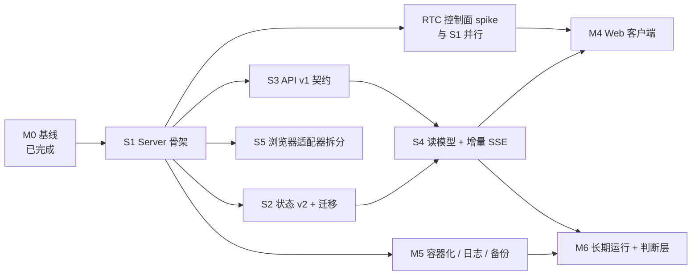

# 实施路线：从验证原型到稳定底层

> 2026-10-19。回答两个问题：**分哪些阶段**、**什么可以并行、什么必须串行**。
> 前置事实见[项目现状分析](../project-status-2026-10-19.md)；证据口径见[验证状态](verification-status.md)。

## 1. 先定义"稳定"：不是功能多，是六类契约可验证

| 契约 | 含义 | 现状 | 达标标志 |
|---|---|---|---|
| 数据 | schema 版本、迁移、备份恢复、单写者 | 单一 `point.validation` v1 文档 + `??=` 增量补丁；备份脚本已就绪但无周期执行 | v1→v2 有迁移与回滚；备份恢复演练通过；旧库可升级 |
| 执行 | 崩溃恢复、幂等、副作用三态 | 已有 70 次强杀证据；`unknown/reconcile` 语义完整 | 每次新增状态变更都补等价故障注入；重放字节级幂等 |
| 接口 | API 版本、错误码、游标、重连 | 无 `/v1`；错误只有 `{error}`；SSE 每次推全量快照 | `/v1` + 错误码对象 + SSE `id:`/`Last-Event-ID` 重放 |
| 资源 | 单写者、浏览器归属/租约、并发上限、成本 | 单写者可靠；浏览器容量 1；无成本预算 | 资源归属可审计；超过容量明确排队/拒绝；有成本上限 |
| 运维 | 容器、拉起、日志、指标、定时备份 | **全部为空**（手工裸跑） | 容器化 + restart + 结构化日志 + 指标 + 定时备份 |
| 演化 | 依赖升级路径、ADR、回归闸门 | pi-durable 1.3.0 锁定，标为实验性 API；ADR-001 已建立 | 升级前固定回归子集 + 状态兼容检查；每季度评估 |

**判断标准**：一个阶段没达到出口判据，就不进入下一阶段；"能跑"不等于"稳定"。

## 2. 路线图：一条关键路径 + 两条并行轨道

关键路径：**S1 → S2 → S4 → M4 → M6**。RTC、S5、M5 都不在关键路径上（前提是 RTC spike 结论不推翻 M4 的浏览器视图设计）。

## 3. 阶段、工作包与出口判据

### M0 基线冻结（已完成 2026-10-19）
git 仓库、`baseline` tag、证据入库、备份脚本 + 恢复演练、CI、凭据入环境变量。
**出口**：全新克隆 `npm ci && npm run check && npm test` 全绿；无凭据入库。

### S1 正式 Server 骨架（1–1.5 周，串行前置）
把原型从"验证工程"变成"产品工程"，**只搬不改语义**。

工作包：
- 目录 `server/src/{api,domain,runtime,adapters,storage}`；`service.mjs` 拆为组合根 + `domain/tasks/{work,report,share,followup}.mjs`、`domain/{jobs,chats,memory}.mjs`、`runtime/bootstrap.mjs`、`runtime/extensions/*`。
- `browser.mjs` 拆 `manager / actions / lease / records`；`steel.mjs` 拆 REST（可 fetch 桩测）与 CDP。
- 配置与凭据注入收敛（`POINT_*` 环境变量）、数据目录布局固定、结构化日志骨架。
- 纯函数抽出并加单测（schemas、job 状态机、memoryPrompt/visibleMessages、requestKey、SSE frame）。

**出口判据**：
- 28 项离线测试在新结构上全绿；`npm run check` 全绿。
- 新增 `test/unit/*` 不 spawn 服务、不写 `runtime/`。
- `grep -rn "defineTask" server/src/domain` 为空（domain 不直接依赖 harness）。
- `git grep -n "fault\|failStep\|verifySteps" server/src` 只出现在测试钩子模块，且默认关闭。

### S2 状态 v2 + 迁移（1–1.5 周，串行，单一 owner）
现状问题：单个 `State` 文档被浏览器、任务、请求共用，每次写都重写整文档；`jobs/requests/actions` 从不清理；`events` 环形截断 200 导致断线丢事件；SSE 快照对每个 job 调 `storage.task`。

工作包：
- 分片：`point.meta`（schemaVersion/migratedFrom/backupRef）、`point.chats` + `point.chat`、`point.memory`、`point.job` + `point.jobs` 索引、`point.browser` + `point.browserIndex`、`point.requests`（统一幂等账本 + 按时段清扫）。
- 事件改 `appendEntry` 时间线，SSE 游标 = commit seq。
- 迁移：在 `harness.resume()` 前用**单个 root commit** 完成 v1→分片；`migrate()` 延迟落 base；版本高于支持则拒绝启动；升级前自动 `backup.mjs` 产出 pre-v2 快照 + sha256 写入 meta。
- 回滚策略：不做原地降级，恢复快照 = 回滚。

**出口判据**：
- v1 夹具库升级后 `/jobs`、`/chats`、`/memory` 语义等值。
- 连续重启 2 次 `meta.migratedAt` 不变（迁移幂等）。
- 恢复 pre-v2 备份后 v1 代码可启动且数据等值。
- `point.requests` 有清扫策略与测试。

### S3 API v1 契约（1–1.5 周，可与 S2 并行）
只动 api 层，不碰事务组。

工作包：`/v1` 前缀；`{error:{code,message,requestId,retryable}}`；所有写操作强制/补幂等键（`cancel`、`stop`、`compact`、`update` 目前缺失）；`/inspect` 加 `--inspect` 门控；`POST /jobs` 重放响应形状统一；SSE `id:` + `Last-Event-ID` + ring 重放（内部仍可先全量）；访问日志带 requestId。

**出口判据**：
- `test/api-contract.test.mjs` 覆盖 400/404/409/413/503 矩阵。
- createJob/createChat/share/revise/memory 重放响应逐字节相等。
- SSE 帧有单调 id，能补发 ring 内帧，空档发 `reset`。

### S4 读模型 + 增量 SSE（1.5–2 周，串行，依赖 S2+S3）
用 `harness.subscribeCommits` 的 `{seq, changes}` 投影取代"每次全量快照"。

**出口判据**：
- 100 job / 10 chat 夹具下 `/state` 的 `storage.task` 调用计数 = 0。
- 单次 commit 只发 O(变更量) 帧；重连回放与首连事件序列 deepEqual。
- `/state` p95 < 50ms。

### S5 浏览器适配器拆分（1 周，可与 S4 并行）
`manager/actions/lease/records` 拆分 + 可替换 backend + 桩测试；保持 `browser-isolation.test.mjs` 断言不变。

**出口判据**：桩测覆盖 open 幂等重放、`unknown` 阻断、reconcile 证据；`test:steel` 5 组全绿。

### M3 浏览器控制面 / 原生 RTC（spike 1–2 周，与 S1 并行；正式集成 2–3 周）
**这是全项目最大的未知数**，且现状比设计文档更糟：原生链路无鉴权、无 session/page 绑定、整屏 1080p、输入走窗口焦点；实测并发 12–13 个未鉴权 offer 即可让容器 panic 退出（`main.go:124` 并发写 WS）。

spike 范围（先做 Steel 补丁，再做 Point 控制面）：
1. **Steel P1**：所有 WS 写串行化（含 ping）——修崩溃；P2：wheel/key 白名单、clipboard 去掉 shell 拼接；P4：连接/轨道状态端点。
2. **Point 网关**：客户端只连 Point；HMAC/JWT ticket 绑定 `browserId + sessionId + pageId + scope(watch|control) + controlEpoch + exp`；watch 只收视频、control 才能输入；逐条输入检查最新控制权；交还/取消/过期 → 关闭旧连接并吊销 epoch。
3. 校验 session live + `live-details` 含该 pageId；坐标按实际帧 1920×1080 换算；不暴露 3000/3001/9323。
4. 自动化套件复用 fork 的 aiortc 接收端 + fixture 表单。

**出口判据（决策门）**：见 §6。

### M4 Web 客户端（2–3 周，骨架可在 S3 后并行）
契约先行：先用 S3 的 mock 起对话/任务/产物三视图，浏览器视图等 M3 决策。**出口**：交代 → 离开 → 回来 → 追问/纠正 → 跟进的真实链路通过；断线重连可重建；浏览器默认观看不能输入、接管后 Agent 被拒。

### M5 常驻化与运维（1–1.5 周，S1 后可并行）
Server Dockerfile + compose（`restart: unless-stopped`、healthcheck、资源限制、数据卷、TZ、非 root）；日志落 stdout 并有保留策略；定时备份；指标；Steel compose 补 `restart`；凭据走 secret/env。

**出口**：容器重启后状态与计划无损；备份恢复演练通过；一次任务全链路可从日志追溯；`docker compose down && up` 后 `/v1/health` 与历史可读。

### M6 长期运行与判断层（2–4 周，依赖 S4 + M5）
7 天挂机压测（内存/句柄/SSE 连接/浏览器泄漏）、供应商故障退避、周期计划、L2 判断策略与评测、成本预算、记忆规模。

**出口**：7 天不重启无泄漏、无丢失计划、无陈旧通知；长跑期间人为注入故障仍可恢复；每新增状态变更都有对应强杀用例。

## 4. 并行 / 串行矩阵

| 工作 | 依赖 | 可并行于 | 说明 |
|---|---|---|---|
| S1 骨架 | M0 | — | 所有人的前置；先把 ports/接口冻结 1 天，再分派 |
| S2 状态 v2 | S1 | S3 | 事务组唯一 owner，**不可与其他改事务组的工作并行** |
| S3 API v1 | S1 | S2、S5、M5 | 只动 api 层，冲突面最小 |
| S4 读模型/增量 SSE | S2、S3 | S5、M5 | 与 S2 都改事务组，必须排在 S2 之后 |
| S5 浏览器拆分 | S1 | S4、M5、S3 | 若 S2 未定 doc 名，先保留旧 State 兼容读 |
| M3 RTC spike | 无（只要 Steel 容器） | S1、S2、M5 | **建议第一天就启动**，不必等服务端 |
| M3 正式集成 | S5、RTC 决策 | S4 | 需要 adapter 骨架 + 控制面协议 |
| M4 Web | S3（骨架）、M3（浏览器视图） | S4、M5 | 契约先行，UI 不能等后端全好 |
| M5 运维 | S1（数据目录布局冻结） | S2、S3、S4、M3 | 容器化不依赖 API 冻结 |
| M6 长跑 | S4、M5 | — | 必须在日志/指标/备份之后 |

**七条硬串行规则**：

1. **状态 schema 改动串行**：S2 与 S4 都碰事务原子组，必须 S2→S4；迁移期间单一 owner。
2. **数据目录布局冻结在容器化之前**：否则卷映射要重做。
3. **控制权协议冻结在浏览器 UI 之前**：否则 M4 的浏览器视图做两遍。
4. **备份/恢复演练必须在真实数据与长跑之前**：否则出事没有退路。
5. **日志/指标必须在长跑之前**：否则泄漏无法定位。
6. **API 契约必须冻结在 Web 联调之前**：Web 可以先用 mock 并行开发，但不能边改契约边联调。
7. **Steel P1 补丁必须在任何真实用户流量之前**：现在任何本机进程可打挂浏览器容器。

## 5. 模块级并行（S1 内部怎么拆活）

先花 1 天冻结接口（`ports` + `api/schemas` + 事件帧格式），然后 4 路并行、文件不重叠：

| 并行路 | 拥有文件 | 冲突点 |
|---|---|---|
| A 领域 | `domain/{jobs,chats,memory}.mjs`、`domain/tasks/*` | 事务闭包签名 |
| B 运行时 | `runtime/{bootstrap,extensions}` | Harness 配置项 |
| C 适配器 | `adapters/{browser,steel,delivery}` | 与领域共享记录结构 |
| D 接口 | `api/*`、`storage/*` | 错误码、幂等键命名 |

单人做则按 S1→S2→S3→S4 顺序；**2–3 路并行是最优**（服务端主线 + RTC + 运维），4 路以上会在状态 schema 与 API 契约上互相踩。

## 6. 风险与决策点

| 风险 | 现状证据 | 处理 |
|---|---|---|
| **Steel 原生链路不可直接上线** | 无鉴权；并发 12–13 连接即 panic 退出（`main.go:124` 并发写 WS）；CDP 在 3000/9323 直通；clipboard 存在命令注入 | P1 补丁为第一优先；补丁前 3001 只留 loopback |
| fork 维护 | 基于未合并 PR 分支 + 4 文件修复；Chrome 155；上游已前进 | 固定 digest；把补丁收敛成小 patch set 并记录升级步骤 |
| 原生媒体契约弱 | 无 session/page 绑定、整屏 1080p、xdotool 窗口焦点输入、滚轮/IME/特殊键不完整 | spike 出口决策 A/B/C |
| 状态膨胀 / SSE 成本 | 单文档、无清理、O(jobs) 快照 | S2 + S4 |
| pi-durable 实验性 API | 1.3.0 锁定；升级无兼容承诺 | 每季度评估，升级前跑固定回归子集 + 迁移演练 |
| 长跑未验证 | 无 7 天数据 | M6 挂机 + 故障注入 |

**RTC spike 的决策门（M3 出口必须回答）**：

- **A. 接原生媒体**：补丁可控、页面级视频可解决、公网 ICE/TURN 可用 → 正式接，Python 桥退役。
- **B. 保留 Python 桥**：原生链路短期不可控（页面级/输入/鉴权成本过高）→ 保留桥但补齐控制面，作为长期债务记录。
- **C. 追加 Steel 页面级补丁后再接**：默认选项，定义补丁范围与时间盒。

判据（全满足才选 A）：自动化用例全绿（含 30 分钟崩溃回归）；1080p ≥25fps、10 分钟丢帧 <5%；输入→DOM p95 ≤200ms（本机）；资源不超过 3 vCPU / 2 GiB；对外唯一入口是 Point 网关且无注入路径；公网 ICE/TURN/TLS smoke 通过。

## 7. 工程量与时间（推断，单人全周 / 2 人并行）

| 阶段 | 单人 | 2 人并行 |
|---|---|---|
| S1 骨架 | 1–1.5 周 | 1 周 |
| S2 状态 v2 | 1–1.5 周 | 1 周 |
| S3 API v1 | 1–1.5 周 | 1 周（与 S2 并行） |
| S4 读模型/SSE | 1.5–2 周 | 1.5 周 |
| M3 RTC | 3–5 周（spike 1–2 + 集成 2–3） | 2–3 周（与主线并行） |
| M4 Web | 2–3 周 | 2 周 |
| M5 运维 | 1–1.5 周 | 1 周（并行） |
| M6 长跑/判断层 | 2–4 周 | 2–3 周 |

关键路径（S1→S2→S4→M4→M6）约 **7–10 周**；若 RTC 结论是 B 或 C，M4 可提前 1–2 周，但技术债明确保留。

## 8. 反模式

1. **在 S1 期间顺手加功能**：骨架阶段只搬不改，否则测试基线失效、无法判断回归。
2. **先做 UI 再定契约**：Web 可以 mock 先行，但契约冻结前不做联调。
3. **把 `server/` 旧代码当新 Server 的基础**：它只提供历史结论，目录只读归档。
4. **在 Steel 补丁前开放浏览器入口**：已实测可被任意本机进程打挂。
5. **跳过备份/恢复就直接跑长任务**：一次磁盘故障会同时丢会话、记忆与证据。
6. **并行引入第二执行引擎**：设计已明确禁止（[runtime-selection](runtime-selection.md:35)）。
7. **把"能跑通"当"稳定"**：每个阶段必须有可运行的出口判据。

## 9. 未来两周的立即行动

1. **Day 1–2**：Steel P1 补丁（WS 写串行化）+ compose 加 `restart: unless-stopped`；写崩溃回归用例。
2. **Day 1–2**：冻结 S1 的 ports/接口草案（`docs/design/server-modules.md`），开 S1 骨架。
3. **Day 1**：启动 RTC spike 的协议验证（不并发打容器；单连接只读）。
4. **Week 1**：S1 完成并通过 28 项测试；M5 容器化骨架并行落地。
5. **Week 2**：S2 状态 v2 + 迁移；S3 API v1 并行；RTC spike 出决策门结论。

达成后，项目才真正具备"底层"资格：**数据能升级、接口能兼容、进程能拉起、故障能恢复、浏览器能被约束**。
