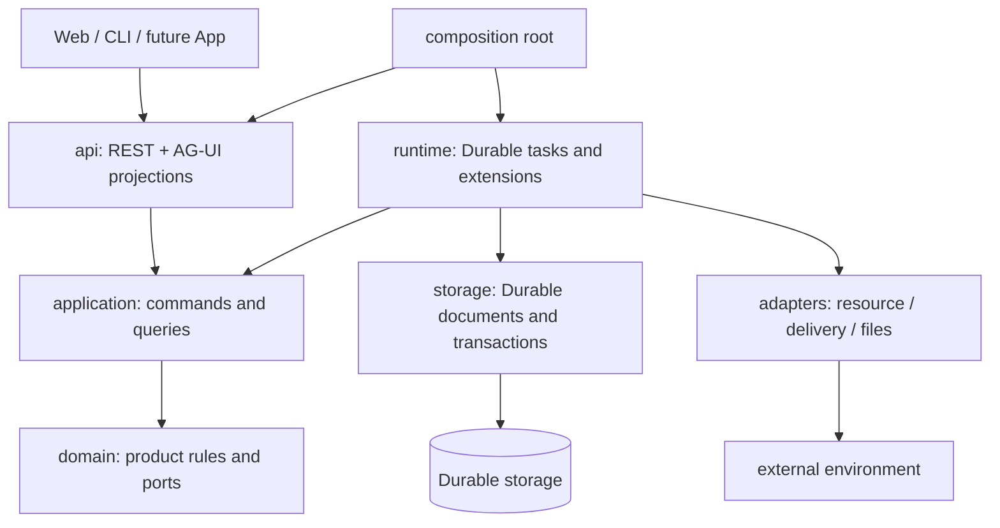

# Point 长期 Server 架构

> 2026-10-19，WP1a。目标架构，不表示下列产品模块已实现。实现与证据以 [验证状态](verification-status.md) 为准；决策理由见 [ADR-002](adr/ADR-002-server-foundation.md)。

## 1. 稳定的核心

Point 是只服务一个人的常驻 personal agent。多个客户端只是同一个人的入口，关闭网页不终止后台工作。Server 是产品主体，Durable 是唯一执行与状态内核，Steel 是独立环境。采用 **模块化单体 + 单进程写者 + SQLite + 独立资源服务**。不建设账号、租户、角色、分布式队列或微服务平台。

长期稳定的是状态所有权、依赖方向、身份与恢复契约，不是永不改变的代码目录。业务扩展主要增加模块与适配器；协议/schema/运行时升级必须有版本与迁移验收。不得为“架构不会改变”承诺虚假的永久兼容。

application 不导入 runtime/storage 的具体实现；实现由组合根注入。runtime 调用 application 纯用例编排，storage 实现事务端口，adapters 实现能力端口。不是让 domain 模拟 Durable SDK，也不是新增调度引擎。跨模块事务由一个用例显式拥有，禁止每个 repository 方法各自 commit。

## 2. 模块职责与代码归属

| 模块 | 负责 | 不负责 |
|---|---|---|
| `api/` | 请求校验、本人鉴权、版本、错误映射、REST/AG-UI 投影 | 产品事实、执行循环、直接外部动作 |
| `application/` | 命令/查询端口、事务边界、用例编排 | SDK 类型、HTTP 类型、独立队列 |
| `domain/` | 会话关系、承诺/目标/工作语义、时间规则、判断与完成判据 | IO、模型调用、具体资源实现 |
| `runtime/` | registry、扩展、Durable Task/checkpoint、恢复、取消与成本钩子 | 另一份任务状态、另一套模型循环 |
| `storage/` | documents、原子提交适配、版本/迁移、可重建读投影 | 自有 messages 表、业务逻辑、外部调用 |
| `adapters/` | files、delivery、resource、未来 connector；执行与观察外部动作 | 判断是否应该执行、自动重放 unknown |
| `bootstrap.ts` | 配置、依赖组装、启动/关闭、失败清理 | 业务策略 |

初始只创建有代码或有明确交付用途的目录，不为每个未来模块建一个 npm 包。将来只有出现独立消费者时才提取共享协议包；前端永远不能 import Server 的 domain/storage。

## 3. 产品身份与事实归属

| 概念 | 稳定身份与含义 | 权威载体 |
|---|---|---|
| Chat | main/主题聊天；归档不删除历史 | directory document + Durable conversation/entries |
| Commitment | 用户答应要做的事；无时间也可存在 | commitment document，来源 entry、revision、截止解释 |
| Goal | 可跨多次工作的长期结果，含完成标准与计划修订 | goal document，关联 commitment/job，而非永久运行任务 |
| Job | Agent 要交付的一件工作，含验收标准/产物/结果路由 | job document |
| Attempt | Job 的一次执行尝试；重试/新修订创建新 attemptId | job 引用 + Durable task；恢复同一次尝试沿用 ID |
| Schedule | 一次或周期唤醒规则，含时区与错过策略 | schedule document + Durable waiting task |
| Decision | 某次触发后选择等待/工作/询问/通知的依据 | decision document/entry，引用触发与策略版本 |
| Interaction | 等待用户补充、草稿发送确认或核销的请求 | interaction document；不依赖内存 Future |
| Delivery | 对话结果/外部通知的投递意图与回执 | delivery document + Durable task |
| Resource | 外部环境的 owner、lease、controlEpoch | resource document；外部现状需观察 |
| Artifact | 已封存产物的版本、哈希、路径、来源 | document 元数据 + 文件卷内容 |
| Profile | 用户明确保存的个性化内容 | Durable document；USER.md 只作导出或显式导入 |

**四种完成不能混为一谈**：Task settled 是引擎结束；Attempt 结束是一次尝试停止；Job 完成要求产物/目标验收；Commitment 完成需要明确用户陈述或可核查结果。Goal 不会因为子任务全部停止自动完成。

工作 revision 与 attempt 分离。取消或修订后，旧 attempt 结果可以保存作审计，但不得覆盖新 revision 或触发陈旧通知。聊天的 stop 与后台 Job cancel 是不同命令，必须明确作用域。上下文会话可以沿用，不能因此复用新尝试的执行身份。

## 4. 命令、事务与副作用

所有写命令带 `requestId`、作用对象、payload hash；需要并发控制时带 `expectedRevision`。相同 key + 相同 payload 重放原响应；不同 payload 返回冲突。账本保存在 Durable document，清理必须有保留策略和到期语义，不能静默把旧请求变成新动作。

核心事务组（正式功能实现时必须落测试）：

1. 接受工作：请求账本 + job/attempt + 创建 Durable task。
2. 结果完成：验证 revision + 产物引用 + job 状态 + 会话结果 entry + 后续投递 task。
3. 修订/取消：revision 递增 + 旧执行取消标记 + 作废旧计划/通知。
4. 用户回答：interaction 从 pending 转 resolved + request 账本 + 恢复工作。
5. 定时到期：occurrence 去重 + decision + 后续等待/工作/投递 task。

同一个业务结果一个 commit，commit 内不得调用网络、模型或写文件。外部动作按以下阶段执行：

`commit(intent, operationId, revision, resourceEpoch) → adapter call → commit(done | unknown | failed)`。

进程在调用前后中断，只要不能证明未发生就标 unknown；恢复先观察，不自动再调用。适配器的“可重试”不能覆盖这个规则。供应商幂等键可降低重复风险，但不宣称普遍 exactly-once。付费模型也需有调用身份、费用未知标记和恢复策略；这项仍需原型审计，不能把现有浏览器验证推广成全部模型调用已符合。

产物文件采用临时写入、校验哈希、原子 rename，再提交引用；文件与数据库不是同一事务。恢复时检查 orphan 文件/缺失引用，不能把半成品作为成功结果。具体实现留 WP7。

## 5. 对话、上下文与个性化

Durable 负责历史投影、工具调用边界、压缩与模型循环。Point 注入有预算和来源的 sections：身份/时间/环境、用户明确保存的 Profile、当前 Chat、当前任务与完成标准、相关产物/决定，以及按需检索结果。低信任网页/工具内容只作为数据，不获得系统指令权限。

原始 entries 不随压缩删除；摘要必须引用来源边界。记录上下文构建的策略版本、引用和截断原因，避免把整个库塞进提示词。文件内容/工具输出限额，图片历史裁剪交给既有上下文机制，不在外面再维护 messages[]。

当前仅显式个性化记忆。早期 USER.md 需求以可读导出/显式导入满足；不能让 USER.md 和 documents 同时可写且都作为权威。导入需版本校验、来源和幂等键；自动抽取、向量检索、跨月记忆整理均单独验收，不在骨架偷偷引入。

## 6. 主动性与长期目标

完整链路是 **触发 → 判断 → 有界工作 → 结果入会话 → 决定是否外部通知**。定时器不是通知器，也不意味着立即调用模型。

先用可审计规则处理已完成、取消、重复、预算不足、等待用户、没有新证据等情形。需要语义判断时才调用模型，保存输入引用、策略版本、选择与理由；模型输出不能绕过完成标准、预算或副作用规则。目标推进一次只创建有边界的 Job，保存下次唤醒，不运行永久思考循环。

保留已确认产品默认：明确承诺自动记下并告知；模糊愿望不创建待办；无截止先记下、不催促；明确完成自动匹配，有歧义才问。提醒时间按工作量判断并告知；到期仍未完成追问一次，之后停止自动催促。停机错过两次提醒合并一次。草稿可提前准备，缺项随原定提醒询问，发送仍由用户决定。第一版暂不增加免打扰设计。

Schedule 保存 UTC 绝对时刻和原始时区/自然语言解释；周期规则与 occurrence key 分开。周期每次都检查当前 revision、目标状态、重复与预算。错过运行采用显式 skip/coalesce 策略，不能恢复时补发无限历史。具体时区/DST和周期边界由 WP9 契约测试决定。

通知渠道单向可替换。对话内完整结果是事实，email/push/系统通知只是提示；同一个 decision 的多渠道重试不生成新业务结果。投递前再次检查任务版本与是否仍值得通知。邮箱不是默认数据源，也不是双向命令通道。

## 7. 资源、浏览器与执行环境

浏览器是重要工作环境，长期通过 resource 端口接 Steel。Point 持有租约与控制权，适配器持有连接。用户接管递增 epoch，所有输入检查 epoch；交回先重新观察。租约过期不意味着网页状态回滚。重启后先核实外部资源，再恢复任务；取消不伪造外部操作撤销。

本次只有边界说明，不接 RTC、viewer、Steel 或其他浏览器功能。WP10 仅修现有风险，正式接入要在资源/状态/API/治理闸门后另立 WP。

命令执行的文件工作区、网络和进程权限必须明确。Docker Server 本身不是任意工具执行的安全沙箱；未来文件/命令 adapter 的隔离与资源限额在开启工具前验收。MCP/skills 属于能力加载，不是新引擎；不能加载任意插件后跳过生命周期/副作用契约。

## 8. 客户端与运行治理

外部使用 `/v1` REST 与 AG-UI 投影，详见 [协议评估](protocol-agui.md)。内部 events 不 import AG-UI。客户端缓存可丢弃并重建，不提交整份聊天历史覆盖服务端。后台 run 与聊天 run 分流；重连落后于保留窗口时返回快照，不把断流标为工作完成。

鉴权是单用户访问令牌，不是用户系统。未完成 WP4 之前骨架只绑定 loopback。正式远程部署由反向代理 TLS、同源、请求限额与令牌保护；媒体也必须过控制权检查，不能直通后端绕开。

运行顺序：配置校验 → 获取目录锁 → 只读检查 SDK schema → 打开兼容存储 → 校验产品格式 → 注册与检查恢复任务 → 恢复调度 → readiness。骨架尚未注册产品任务，因此不启用调度。关闭先拒绝新命令，再停接口与运行时，最后释放锁；异常终止由 supervisor 拉起。

数据目录长期约定：`state.sqlite`、技术锁 `owner.sqlite`、`workspace/`、`artifacts/`、`tmp/`；凭据在外部只读挂载，不在产物或备份默认内容中。备份必须用 SQLite 在线快照，并协调产物引用，不能直接 cp WAL 文件。恢复演练先于真实部署；历史数据迁移先停写、备份、验证再切换。旧程序不得打开新版库。

治理围绕 chat/job/attempt/operation/decision/delivery ID 关联，分别记录取消、失败、unknown、等待用户、限流、成本未知；日志不包含凭据或默认全文内容。限制并发、步骤、时间、token、费用与重试次数。耗尽预算保存状态并等待，不能通过新建子任务无限绕过。长跑以资源趋势、计划不丢失与用户体验验收，不能凭一次短测宣称成熟。

## 9. 本次实际交付与演进

WP1a：TypeScript 模块边界、真实 Durable 初始化、单写者、健康接口、关闭、独立测试、构建检查与上述设计。当前 metadata 仅基础 format，**不是 WP3 的业务 v2 schema**。

WP1b：在这些边界内按产品契约工程化重建，以独立行为与失败矩阵通过为出口；原型只作参考，详见 [核心重建计划](agent-core-rebuild.md)。随后 WP2–WP9 建立资源、版本、API、读模型、行为与运行治理。长期产品闭环和浏览器恢复集成见 [路线](roadmap.md) 的后续工作包。每个未实现能力保持显式 pending，不用空端口或模拟成功冒充完成。
