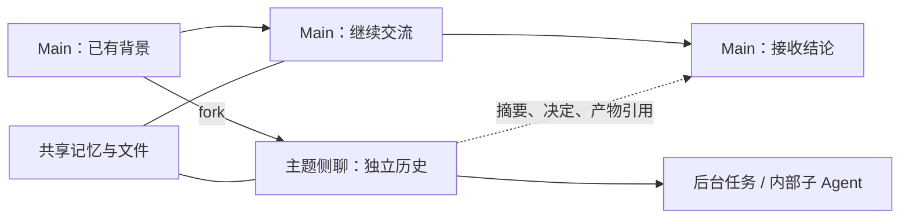

# Muse 会话设计与 Pi Durable 对照

日期：2026-10-18，Asia/Shanghai。对象是 Meta 的个人 Agent Muse；Muse Code、nanoMuse、OpenMuse 的同名功能没有作为该产品的实现证据。

> 同日后续实现：原型已补齐主题侧聊、fresh/fork、共享显式记忆、模型可见的结果回传及主题结论同步。第 7 节保留的是调研时的原型状态，最新功能与验收见 [原型说明](../../infra/pi-durable-validation/README.md)。

## 结论与证据强度

Muse 的主线产品设计可确认是：**长期主会话，辅以按主题组织的侧聊，以及跨会话的记忆。** Git 分支类比能够解释部分上下文分叉行为，但现有材料不能证明完整历史的自动 merge、rebase 或冲突解决。

| 问题 | 调研结果 | 证据强度 |
|---|---|---|
| 是否有长期 main？ | 官方把主会话作为持续交流入口 | 高：官方设计文章、设计负责人访谈 |
| side chat 是什么？ | 为主题提供独立上下文，也可持续使用 | 高：官方意图；持久接口来自第三方工具记录 |
| 能否继承 main 的背景？ | 公开工具记录描述 `context_mode: fork / fresh` | 中：第三方采集，未独立调用真实账户验证 |
| 是否自动合并完整历史？ | 没有找到可确认的接口或官方说明 | 未确认；不能把未找到解释为绝对不存在 |
| 信息如何跨会话流动？ | 共享记忆；公开记录另有历史读取与跨会话消息工具 | 官方支持共享记忆；工具细节为公开采集线索 |
| side chat 等于子 Agent？ | 用户会话与后台委派是不同的产品对象 | 公开提示词、工具记录分别描述二者 |

本轮读取了公开网页和第三方捕获材料，没有操作 Muse 登录账户；下面的工具行为不是实时实测结果。

## 1. 官方为什么保留 main

官方设计文把主会话定位为持续交流的地方；当主题与项目复杂起来，一部分用户需要独立上下文，才引入侧聊。跨会话记忆让用户面对的仍是同一个个人 Agent。[官方设计文章](https://introducing.muse.ai/)

设计负责人 Alex Cornell 在 How I AI 访谈的 25:28—27:56 解释：main 是刻意设立的主要交流线，用户可以一直使用它；侧聊用于限定主题、组织工作。他同时承认主/侧聊的组织和理解方式仍有改进空间。[访谈转录](https://ulisten.ai/channels/how-i-ai/meta-muse-the-ai-agent-people-actually-love_4TOLm1g-gCE/transcript)

产品上的含义是：main 承载持续关系，侧聊承载主题范围；新任务未必对应新会话，一个主题会话也可承载多次任务。这是对上述设计意图的归纳。

## 2. fork 与 fresh 的线索

Jules Kuehn 的公开架构笔记包含采集的工具说明：`chat.create` 提供 `fork` 与 `fresh`；前者携带主会话背景，后者从没有既往对话背景的上下文开始。记录还将侧聊描述为持久会话，并列出归档、读取历史、向另一会话发送消息等操作；发送消息并不把目标会话的回复同步带回当前调用。[公开工具记录](https://gist.github.com/juleskuehn/480139a0ea9509e9b085459a045e03dd)

该资料是第三方记录，标题也明确说明来自与 Muse 的交互。它支持具体机制的推测，不替代官方接口承诺；不能据此断言数据库内部使用 Git 式 DAG。

## 3. 共享记忆与读取历史，并不要求拼接会话

公开捕获的系统提示词把主/侧聊都描述为可压缩的长期对话，并区分保存的记忆、文件和原始聊天记录；缺少细节时，分别搜索记忆或读取原始会话。它还单独描述后台子 Agent 的继承与结果返回。[公开提示词](https://gist.github.com/sergiotapia/ffef70d582a9ad5e9062d0c30d67fc19)

另一个第三方发布的客户端说明将 side chats 定位为按主题组织的会话，并区分用户界面的跨会话搜索与 Agent 按会话读取历史。[公开客户端说明](https://github.com/win4r/MuseAI-Skills/blob/main/home/hatch/docs/client-surfaces.md)

因此，某个侧聊中的事情后来在 main 被提起，可能来自记忆、检索或消息转交；这种表现本身不足以证明历史合并。以上捕获材料的来源与时效均不能视为官方保证。

## 4. 其他人的实际使用分析

| 来源 | 对会话设计有用的观察 | 局限 |
|---|---|---|
| [MBI：First Impression of Muse](https://www.mbi-deepdives.com/muse/) | 作者为播客分析创建侧聊，工作跨夜完成后回来查看 | 一次使用经历，不能证明底层分叉或合并实现 |
| [用户讨论：Main 与 Side Chats 怎么分工](https://www.reddit.com/r/MuseAgent/comments/1x7xs6g/how_do_you_personally_set_up_your_main_chat_vs/) | 有人用 main 处理跨主题事务，侧聊持续承载项目；也有人反馈多会话信息不一致 | 使用策略与个案，不是产品规范 |
| [用户反馈：消息进入错误会话](https://www.reddit.com/r/MuseAgent/comments/1x46dw6/side_chats_leaking_into_main_chat_and_side_chats/) | 后台结果的目标会话可能与用户预期不一致 | 未复现，不能据此判断普遍程度或根因 |

这些反馈提示一个独立的产品问题：**知道某件事，与把结果投递到正确的会话，是两件事。** 不能只实现共享记忆，就认为主/侧聊协作已解决。

## 5. Durable 能否实现相同的产品结构

以本机锁定的 Durable 1.3.0 接口为准：

| 产品需求 | Durable 对应能力 | 需要 Point 定义的部分 |
|---|---|---|
| 长期 main | `harness.root()`，重开相同存储取得同一主会话 | 主入口、上下文与记忆策略 |
| 从已有背景开侧聊 | `conversation.fork(entryId, …)` | 何时分叉、用户是否看见、名称与主题 |
| 新背景侧聊 | `createConversation()` | 需要传入哪些摘要、引用和共享记忆 |
| 持续后台执行 | task-owned conversation 与 background task | 用户会话与执行任务如何关联 |
| 结果回到 main | 向 main 提交输入或模型可见条目 | 摘要、决定、产物引用与去重规则 |
| 归档主题 | 应用状态或文档 | 归档是否影响任务、通知路由和检索 |

Fork 继承分叉点之前的历史，之后独立前进。文档状态有各自的 fork 策略，不能理解为所有应用状态自动复制。官方说明见 [More Conversations and Forks](https://github.com/earendil-works/pi/blob/main/packages/durable/README.md#more-conversations-and-forks)。

本机公开 [Conversation 接口](../../.research/repos/pi-repo/packages/durable/src/harness/types.ts) 有 fork，没有通用的会话 merge 方法。分叉的历史关系与 task ownership 的执行/取消关系也不同：一个 fork 不必是另一个 Agent 的受控后台工作。

会话隔离不自动隔离文件系统。多个会话使用相同工作目录时，文件修改仍可能相互影响；若需要 Git worktree 的文件隔离，要另外配置。

## 6. 对 Point 的具体建议（设计建议，不是 Muse 已证实实现）

保留三个独立对象：

- **用户会话**：main 与可以长期存在的主题侧聊。
- **执行任务**：某次调研、生成或跟进；属于某个用户会话，可拥有内部子 Agent。
- **共享记忆与产物**：存放跨主题有价值的事实、决定和文件，通过来源引用关联。

下面的回传箭头表示应用层消息与知识整合，不表示现成的 Git merge：

合并可先做成类似 squash 的效果：保留侧聊原始历史，向 main 提交经过整理的结论、已确认决定和产物引用。不要默认把全部工具输出拼进 main；暂时探索也不应自动成为持久偏好。需要 main 更新理解或继续处理时，回传内容必须进入模型可见上下文。

任务应记录来源会话和投递会话；归档时显式决定如何处理尚未结束的工作。原会话长期存在与某次任务已完成应分别记录。

## 7. 当前 Demo 与这个模型的差距

当前 [原型实现](../../infra/pi-durable-validation/src/service.mjs) 使用 `createConversation()` 创建任务拥有的独立子会话，没有调用 `fork()`。任务输入是显式构造的要求与偏好，不默认继承 main 历史。

完成后写入 main 的 `point.result` / `point.followup` 只有自定义数据，没有 `model` 内容：CLI 可以展示它们，但这些条目本身不进入主 Agent 的模型上下文，也不自动启动主 Agent 整合。主 Agent 若主动调用 `list_jobs`，则能读到任务结果。

因此，Demo 已覆盖内部后台执行与恢复，还没有实现用户可见的主题侧聊、侧聊 fork、模型可见的结果回传或知识整合。本轮调研没有修改运行代码，也没有切换正式运行时选型。
