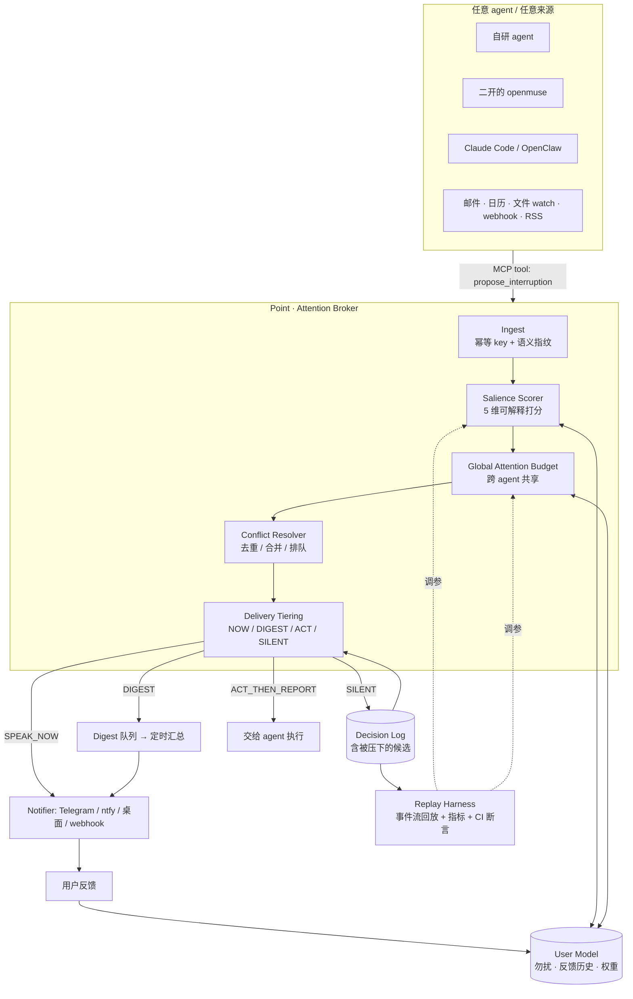

> 历史调研说明（2026-10-16）：本文保留当时的调研与建议。现行产品范围和运行时选型以 [设计索引](../design/README.md) 为准；2026-10-18 已改为 Pi Durable（Agent 层）+ Steel（浏览器基础设施），并明确包含 Server 端浏览器与完整执行能力。旧的“不做浏览器/容器”等范围限制不再适用。

# 持续运行 · 主动交互的 Personal Agent —— 调研报告与 Point 立项建议

> **v2 修订版**（v1 有一处重大误判，见 §3，已纠正）
> 调研时间：2026-10-16（Asia/Shanghai）。star / license / 活跃度均于当日实时查询。
> 本文为「Point」项目的立项前置调研。用户约束：**简历项目、完全开源；OpenClaw / Hermes 类重型底座不考虑；agent 层自研或二开。**

---

## 0. TL;DR

| # | 结论 |
|---|---|
| 1 | **赛道被两端同时定义**：Meta Muse（2026-09-08）+ **OpenAI dot（就在今天 2026-10-16 开始灰度）**。两家都给了「always-on + 自己的云电脑 + 主动 + 记得你 + 审批」。 |
| 2 | **你说的 "dot" 有两个，别搞混**：New Computer 的 Dot 已在 **2025-10-05 关停**（创始人愿景分歧）；而 **OpenAI 今天刚上线了名为 dot 的 always-on agent**。后者才是当下的对标物。 |
| 3 | **两个开源仓库都不能直接抄**：`CopilotKit/openmuse`（MIT，5.1k★）形态最好但**强依赖闭源 SaaS**；`nano-muse/nanoMuse`（GPL-3.0，1.3k★）最完整但**GPL 传染 + 4 端工程量爆炸**。 |
| 4 | ⚠️ **v1 的一个误判**：我原以为「主动性评测」是空白，可以当卖点。**错。** 学术上已有 **60+ 个 proactive agent benchmark**（含 PROACTIVITY-GYM / TRACE / OverAct / VibeLifeBench），工业上已有 `refixai/proactivity-sdk`。见 §3。 |
| 5 | **修正后的建议**：Point 不做 agent（你自己做/二开），做 **「跨 agent 的注意力治理层 + 可插拔的运行时评测 harness」**——即「让任何 agent 懂得什么时候闭嘴」。这是大厂不做、学术界只做离线数据集、现有 SDK 只覆盖单 agent 的那个空档。 |
| 6 | **市场自己给了这个定位背书**：Meta 官方设计手记原话——"the bar for sending one has to be high: **a proactive message has to be genuinely helpful and worth the interruption**"，而它的解法只是「默认保守 + 一个旋钮」。**行业第一名公开承认这是核心难题，却只给了一个开关。** |
| 7 | **Muse 的信任已经出问题，而裂缝全在软件层**：The Future Society 从 Muse 自己导出的 VM 里挖出 47 项发现——**给每个非用户建关系档案**、「忘记」只改笔记保留 transcript 且**指示 agent 不要告诉用户**、平台推断与用户明说刻意混同。加上 0-day、Amazon/JPMorgan 封禁、TechCrunch 评「party trick」。**技术架构不是护城河，信任才是** —— 这三条裂缝恰好开源项目最容易做对。 |
| 8 | **同类几乎全灭**：Rewind 日落 / Humane 关停（HP $1.16 亿收资产）/ Limitless 被 Meta 收购 / Sana 被 Workday $11 亿收购 / Mindy 团队解散 / Personal.ai 退 B2B / Notion Mail 关停。**死因集中在定位漂移、硬件放大器、价值不可度量。** |
| 9 | **技术选型有雷区，且「完全开源」这条要求一次砍掉 11 个高星选项**：`microsoft/autogen`（61,434★）已进 maintenance mode 且 license 是 **CC-BY-4.0**；inngest = **SSPL v1**、n8n（207,561★）= Sustainable Use、suna = Elastic License 2.0、FalkorDB = SSPL、phoenix = ELv2、mastra/langfuse = 核心开源 + `ee/` 闭源。**另有 3 个 star 泡沫**（Second-Me 15,682★ 但 12.5 个月无提交）。详见 §4.6 与 [tech-stack-selection-2026-10-16.md](tech-stack-selection-2026-10-16.md)。 |
| 10 | **「必须能换模型」不是洁癖，是生存条件**：Anthropic 禁止 Claude Code 订阅用于 OpenClaw（HN 1,099 pts）、Google 限制 AI Pro/Ultra 订阅（802 pts）、Claude Code 对提到 OpenClaw 的 commit 拒绝或加价（1,349 pts）。→ 这条要写进 Point 的 README 当卖点。 |
| 11 | License：**Apache-2.0**。 |

---

## 1. 赛道现状：两超 + 一开源巨兽

### 1.1 Meta Muse（2026-09-08）

来源：[about.fb.com 官方公告](https://about.fb.com/news/2026/09/introducing-muse-personal-ai-agent/)（已抓取正文核对）

官方定义的五条构成要件——**缺任何一个都不算这个品类**：

1. **做事而非回答**："It doesn't just answer questions, it actually does the work."
2. **关掉 App 之后继续跑**："Muse keeps working after people close the app, and comes back when something changes or when it needs approval."
3. **主动**："proactively helps with people's goals and suggests ideas"；"**make suggestions unprompted** and act on details that person only mentioned once."
4. **独立审批层**："A separate **Sentinel agent** runs on that same machine, kept apart from Muse at the system level. **Nothing Muse does reaches the internet unless the Sentinel approves it**."
5. **凭据隔离**："Muse has **no visibility into people's passwords or payment methods**."

配套：**Muse Secure VM**（每用户一台专属云 VM）、**Muse Spark** 模型、**Link by Stripe** 支付（一次性卡号 + 购买保护）、入口是 Muse App + **WhatsApp**。后续将推出 **Muse Confidential VM**（密钥仅用户持有）。

> **护城河不在 agent，在 VM / 支付 / 身份 / 分发。**

**官方设计手记里的原话（这是全篇最重要的一句市场验证）**：
> "Muse is also proactive. It can send you messages without you prompting it. **Which means the bar for sending one has to be high: a proactive message has to be genuinely helpful and worth the interruption.** We think the default is right for most people, and you can always tell your Muse to turn it off, dial it down, or dial it up."
> —— [introducing.muse.ai](https://introducing.muse.ai/)

**市场领导者亲口承认「值得打断」是核心难题，而它的解法只是「默认保守 + 给用户一个旋钮」。** 这正是 Point 要工程化的东西。

**真实架构**（来源：[security.muse.ai](https://security.muse.ai/) 架构深潜 + [The Future Society 对 Muse 自身 VM 导出件的分析](https://futuresociety.ch/muse-findings/)，47 findings / 164 条带行号引文）：

| 组件 | 做法 |
|---|---|
| `Muse Secure VM` | 每用户一台专属云 Linux，装 agent + 该用户全部数据与凭据；客户端直连自己的 VM |
| 两层隔离 | agent harness 跑在 `systemd-nspawn` runtime cell；cell 内 root 映射为非特权宿主用户；独立 rootfs；过滤 syscall（禁 io_uring）；限制 capability |
| cell 外的独立 systemd unit | `hatch-safety`（独立分类器集合，检测 prompt injection 与前沿风险）、`privsep`（连接器业务逻辑，凭据不出域）、`hatch-authd`（凭据存储 + 代理） |
| **Sentinel** | 宿主侧独立 agent，**唯一权限权威**——所有连接器动作与网络出口都须其批准，**Muse 只能 propose**。在 L4/L7 检查 hostname / 解析后 IP / 端口 / 协议 / HTTP method+path / 解码后的请求体，做 SSRF 防护 |
| **凭据代持** | runtime cell 里只看到 surrogate token，真实凭据在 Sentinel 出口处才替换 —— **agent 永远看不到真 token** |
| **tainted egress** | 用 **eBPF cgroup 程序**做内核级数据流跟踪：进程读到用户数据就被「污染」，污染进程失去 auto-allow 资格，回落正常审批 —— 目的是**平衡审批疲劳** |
| 审批 | 是 **capability 不是建议**：一次批准绑定特定连接器/目的地/用例，支持一次性、会话级、任务级、时间限定、永久 |
| 浏览器子 agent | 透过 CDP broker，只看 accessibility tree 快照不看原始 DOM，不能在页面上下文跑 JS，Chrome DevTools 禁用 |
| 注入防御纵深 | 模型层训练 + harness 层「外部数据入 context 即标记不可信」+ 多个独立分类器集成 + 出 VM 动作人工审批 + 底层确定性边界。**公开 bug bounty 最高 $300K**（其中成功 prompt injection 最高 $130K） |
| 模型 | 自研：Muse Spark 1.3 → Muse Wonder / Wonder Full（2026-10-12） |

**主动性怎么实现的**：目标 + 排程 + 事件驱动的后台 job，文档显示约 **24 个每日 cron**（每小时人物档案、每小时记忆抽取、夜间 self-improvement、feed pulse 00–23）；agent 自称有 **62 个 skills**（gmail / google-calendar / spotify / instagram / facebook-cli / messenger / booking / shopping / goals / forget / health / tessie / philips-hue …）；会「启动 subagent 集群、自建工具、自我编辑」。

**记忆模型（★ 最值得抄的一点）**：**不是黑盒向量库，而是 VM 里的纯 Markdown 文件，用户可直接编辑**。
```
MEMORY.md   USER.md   SOUL.md   IDENTITY.md
~/memory/people/*      # 每人一页关系档案
~/memory/groups/*      # 每群一页
~/memory/bank/{world,experience,opinions}.md
~/memory/shopping/PROFILE.md   # 尺码/品牌/支付方式/配送偏好/约束(过敏)
```
检索是混合式：`muse.memory_search` / `muse.memory_get` / `muse.context_fetch`（可自由文本搜全历史）。写入是定时批处理：每小时 memory-extraction、每小时 Relationships、夜间 self_improvement。
**但确实存在中心化外发**：forget skill 的 artifact inventory 明确列出 "centrally published user-memory embedding for the VM"、**fleet-learning outboxes**、centrally published lessons、Discovery Pool cards。

### 1.2 Meta Muse 的信任裂缝（一手取证，这是全篇最有价值的部分）

来源：[The Future Society《Muse, in its own files》](https://futuresociety.ch/muse-findings/)（基于 2026-09-24 开发者诱导 Muse 导出自身 VM 的 281MB 副本，含文件路径与行号引用）· [Gizmodo 报道](https://gizmodo.com/metas-muse-is-collecting-information-on-everyone-in-your-life-2000689000) · [WIRED](https://www.wired.com/story/muse-creates-detailed-profiles-of-all-your-friends-and-family/)

| 发现 | 细节 |
|---|---|
| **给非用户建持久档案** | 每小时的 Relationships job 为「每个与用户有真实关系的人/群组」写一页，含「该如何与这个人沟通」「**你在私信里对 TA 许下的承诺**」。**这些人不必是 Muse 用户，也没有任何同意渠道。** 对比：goal-creation skill 明确**禁止**推断他人敏感特征，而每小时 Relationships prompt **没有这条约束** |
| **「忘记」不彻底且刻意隐瞒** | 内部文档：问 Muse 忘记某事「**只编辑记忆笔记、保留 chat transcript**」；forget skill **明确指示 agent 不要告诉用户这一点**；隐私文档称主对话 "**can never be deleted**" |
| **推断与明说被刻意混淆** | Instagram skill 被指示「把平台推断出的兴趣当作我知道的呈现」——抹掉「用户明说的」与「平台推断的」界线；agent 还能**反向写回**改变推荐内容 |
| 敏感类别无护栏 | 每小时记忆抽取指令里 `grep -rniE 'sensitiv\|special categor\|health\|religio\|sexual\|politic'` **零匹配** |
| 搜索黑名单带编辑立场 | 搜索二进制里 **267 万域名**黑名单含 nytimes.com / washingtonpost.com / theguardian.com / bbc.com / apnews.com（与 Reddit、Stack Overflow、色情/垃圾站同类目），而 Fox News、WSJ、CNN 等 295 个 "contract publisher" **不在**名单上 |
| 阻止用户投诉 | 文档要求 agent「**不要就 Muse 慢、贵、受限或坏掉提供反馈入口，包括宕机和模型质量**」 |

**外部的三重打击**：
1. **0-day**（macOS 安全专家 Patrick Wardle）：任何本机 app 或终端命令都能改一个未公开设置，把语音转写 endpoint 指向攻击者服务器，**拿到完整控制 Muse 账户的 token**；PoC 包括写恶意文件、偷拍照片，**多数情况下用户毫无提示**。根因之一是 Meta 选择**云端转写**（macOS 本有本地转写能力）。Meta 在披露后约 12 小时发 hotfix。[Ars Technica](https://arstechnica.com/security/2026/09/muse-metas-extraordinarily-privileged-ai-assistant-has-a-serious-0-day/)
2. **平台反制**：**Amazon 于 2026-09-20 起封禁 Muse 购物**（"unauthorized AI agent violates Amazon's Conditions of Use"）；**JPMorgan 禁止外部 AI agent 访问客户账户**，Jamie Dimon 原话："**You don't want rogue agents**"（2026-10-13/15）。
3. **留存未被证明**：TechCrunch 记者实测——Muse 帮他找到一笔 unclaimed funds 并真的收到支票，但他称之为 **"a party-trick type thing"**，一次性的、不可重复的，"除此之外我没找到什么真正有用的"。[TechCrunch](https://techcrunch.com/2026/09/27/can-muse-overcome-metas-trust-issues/)；CNBC 标题即结论："Meta's Muse assistant tops app charts. **Now it needs to become a habit**"。

> **结论**：Muse 把主动性做成了**工程问题**（VM + 独立权限进程 + 后台 job），但**技术架构不是护城河，信任才是**。而它信任崩塌的三个点——**删除不彻底 / 给非用户建档 / 推断与明说混同**——恰好都是**纯软件层可以轻松做对的**。这是开源项目的机会。

### 1.3 OpenAI dot —— 就在今天上线

来源：[help.openai.com — Getting started with your dot](https://help.openai.com/en/articles/20001530-getting-started-with-your-dot)（页面显示 "Updated: 7小时前"，2026-10-16 抓取）

| 维度 | 内容（官方原文要点） |
|---|---|
| 定位 | "Your dot is an **always-on agent in ChatGPT** that can help you take a project from an idea to work you can use." |
| 持续运行 | "Give it a goal, share the context, and it can **keep making progress between conversations**." |
| 自主性 | "**With its own computer** and the apps you connect, your dot can research, create, and follow through on tasks." |
| 模型 | **GPT-6 Astra** |
| 记忆 | "It starts with context from **ChatGPT memory**…"；"Your dot can also **review that information proactively and form memories from it, even when you haven't asked a specific question about it.**" |
| 人控 | "**You choose what it can do on its own**, review its work, and give feedback or change direction as you go. **You can pause it at any time.**" |
| 自有电脑 | "Your dot has its **own cloud computer**." 本地电脑访问**默认关闭**，需在 ChatGPT 桌面版上确认 `Allow access`，可 `Revoke access`。 |
| 任务视图 | Profile → **In progress / Scheduled / Completed** |
| 集成 | 可创建 **Work 或 Codex 任务**、使用本地 skills、云浏览器被拦时用本地浏览器；messaging 渠道（如 Slack、短信）需在桌面端连接 |
| 命名 | 默认 handle `@yourname-dot`，改名后 `@yourname-agentname` |
| 定价 | **Pro / Business Premium 用户**（不含 EEA / 瑞士 / 英国）；Enterprise/Edu/Healthcare 需管理员开启 beta，默认关闭。首个 dot 免费含在套餐内，"available 24/7"，另含深度工作额度；未来可购买更多 dot、按速度或工作量扩容 |

### 1.4 两个 "dot" 的澄清（重要）

| | New Computer **Dot** | OpenAI **dot** |
|---|---|---|
| 时间 | **2024-06 上线 → 2025-10-05 关停** | **2026-10-16 起灰度** |
| 定位 | 情感陪伴 / 自我认知（companion） | 目标驱动的 always-on 执行体（operator） |
| 死因（一手） | 官网公告：创始人 **"Northstars as founders had diverged"**；战略从 personal intelligence 漂向 social intelligence 后关停。30 天缓冲期 + 数据导出。 | — |
| 来源 | [new.computer](https://new.computer/)（页脚 © 2023-2025；Wayback 显示讣告页 2025-09-11 已上线） | 上面的 help 页 |

> **教训**：Dot 不是技术失败，是**定位漂移 + 单一公司依赖**。用户数据与「关系」随公司一起归零——这正好支撑 Point 的「本地优先 + 可导出」叙事。

### 1.5 Dot 的真实规模，以及同类产品的「同一张告示牌」

**Dot 的一手时间线**（来源：[new.computer](https://new.computer/) 讣告 + [TechCrunch 2025-09-05](https://techcrunch.com/2025/09/05/personalized-ai-companion-app-dot-is-shutting-down/) 报道）：

| 项 | 事实 |
|---|---|
| 时间线 | **2024-06 上线 → 2025-09-05 宣布关停 → 2025-10-05 停止**，公司 wind down，**未被收购** |
| 团队 / 融资 | **5 人**团队，**$3.7M** pre-seed（含 OpenAI Fund） |
| 技术 | 编排约 **10 个第三方 LLM**（OpenAI / Anthropic / Google / 开源）；记忆数据结构**未公开** |
| 定价 | **$11.99/月**（Chronicles + 无限对话） |
| **规模真相** | 官方口径「数十万用户」；**Appfigures 实测 iOS 总下载仅 24,500**（且从无 Android）—— **10 倍差距** |
| 主动性的性质 | **情感性**：onboarding 后持续深挖动机（TechCrunch 形容「像面试的初次约会」）、主动共情追问、无限档下**主动收尾送客** |

**同类产品的结局几乎是同一张告示牌**：

| 产品 | 结局 |
|---|---|
| **Rewind**（Limitless 前身） | 已日落 |
| **Limitless** | **2025-12-05 被 Meta 收购**；停售 Pendant，现有客户免订阅支持至 2026 年底；**非 Pendant 功能日落**；EU/UK/中国等服务终止 |
| **Humane AI Pin** | **2025-02 关停**；HP 以 **$1.16 亿**收购资产与约 300 项专利，**Pin 服务器关闭**，部分用户无法退款 |
| **Sana** | **2025-09 被 Workday 以 $11 亿收购** |
| **Mindy** | 团队整体加入 WorkWhile，产品线终结 |
| **Friend** | 靠争议存活：$99（2025-01）→ **$249 + 月费**（2026-07 的 2.0）；纽约地铁广告被反复涂鸦，被 NYT/CNN 当作「反 AI 反弹的符号」 |
| **Personal.ai** | 退向 B2B / 基础设施（Memory Core / Persona Studio） |
| **Notion AI Agents** | **运营中但需用户显式触发**；**2026-06 Notion Mail 关停**，官方归因于「AI agent 让 inbox app 变得冗余」 |
| Kin / Oasis | **未能确认**（无非一手可验证的「常驻+主动」产品） |

> **这张表对简历项目的意义**：这个品类的**死亡率极高**，且死因高度集中在三处——**定位漂移（Dot）、硬件放大器（Humane/Friend）、价值不可度量（companion 赛道）**。反过来说，**一个能证明「我让主动性变得可度量」的项目，恰好回答了这条赛道最缺的东西**。

---

### 1.6 这对简历项目意味着什么

- 消费者侧的「全能 personal agent」已经被两朵云免费/半免费地商品化了。**做一个更差的版本 = 浪费 3 个月。**
- 两家都暴露了**同一个未解难题**：OpenAI 的解法是「你自己选它能做什么 + 随时暂停」；Meta 的解法是「Sentinel 审批 + 审计」。**两家都没有解决「它该不该现在开口」这个问题**——它们把决定权推给了用户配置。
- 而这恰恰是学术界这两周在密集研究的（§3.1）。

---

## 2. 你点名的两个开源仓库

### 2.1 CopilotKit/openmuse

来源：仓库 + README/ROADMAP/package.json/源码（子代理已完成逐文件级深挖，以下为核验后要点）

**元数据**：MIT · **5,099–5,101★** · 709 forks · TypeScript ~99.4% · 创建 2026-09-15 · 主分支最后提交 **2026-10-06** · **无 release/tag**（仅 `0.1.0-alpha`）· 41 个 open PR 积压。

**它是模板/参考应用，不是 runtime**。运行时来自 `@copilotkit/runtime@1.70.1`；官方产品家族里还有 OpenBot（6,526★）、**OpenDots（5,437★，"Always-on AI coworkers that move between text, calls, and Slack"）**、OpenTag。

**架构**：Expo/React Native 三端 + Hono API + AG-UI 协议 + PGlite/Postgres + Playwright 浏览器 worker + 可选 Docker/E2B 计算机。

**最值得抄的四件事**（这是子代理报告里最有价值的部分）：

1. **SQL 租约任务引擎**（`apps/server/src/engine/worker.ts`，~250 行）：1 秒 tick 轮询 + CAS 抢租约（`leaseUntil = now+60s`）+ 心跳续租（`leaseMs/3`）+ `checkpoint()` 落中间态 + `guard()`/`LostLeaseError` + `runs` 审计表 + **租约过期自动抢回**。**进程重启后 `maintain()` 重发未发布结果。**
2. **审批/回执层**（`actions.ts`）：外部写操作走 `propose() → 人工审阅 → claim() → 执行`；**幂等键 = sha256**；绑定 `connectionId` 与 `targetVersion`（日历 ETag）；状态含 `outcome_unknown`——**不确定的外部写操作绝不自动重试**。
3. **存储极简**：单表 `records(owner, kind, id, data jsonb, updated_at)` + `data @> $expected::jsonb` 做乐观并发 + `insertIfAbsent` 去重。180 行，`DATABASE_URL` 一改就从 PGlite 上 Postgres。
4. **页面变化去抖**（`page-diff.ts`）：sha256 + **剥掉相对时间的 fingerprint** + 行级 diff。注释原话：*"Only relative times changed anywhere on the page ('3 minutes ago'): keep watching quietly."*

**主动能力现状**（注意：**它是「持续运行 + 把结果推给人」，不是 agent 自发开话题**）：
- `Monitor`：周期检查页面 `change` / `contains` / `price_below`，间隔 1min–7d，失败 ≥5 次自动 `paused`，告警按稳定 key `insertIfAbsent` 去重。
- `Ideas`：每 15 分钟刷新建议，带 `reason` + `Evidence[]`（`mail|file|web|user`），可 edit/accept/dismiss，accept 会开出真任务。**但 `docs/VERIFICATION.md` 自承是「Rules-based suggestions」，不是模型驱动。**
- 通知：持久化 in-app 收件箱。**关键克制——主动输出只进收件箱与卡片，绝不往对话流里插消息。**

**致命硬伤（对你的「完全开源」是决定性的）**：
- **CopilotKit Intelligence 在每个模式下都是无条件强依赖**：`config.ts` 里 `required("CPK_INTELLIGENCE_API_KEY")`；README 原文 *"Intelligence is a separate service and **is not included in this repository's MIT license**."*
- 社区已反弹：issue **#73**（要求可选，仍 open）、issue **#179**（要求 keyless 本地线程存储，并附了第三方 fork `caspianchan31/openmuse-standalone`）。
- 单 owner 非多租户；宿主必须常驻；PGlite 不能多进程；浏览器 worker 自承 *"application-enforced egress policy, not a kernel firewall"*。
- **OpenDots 同样如此**：README 明说 "Conversations require CopilotKit Intelligence"（或购买 licensed self-hosted deployment）。

> **结论**：openmuse 是**最好的架构教科书**，但**不是可完全自托管的底座**。

### 2.2 nano-muse/nanoMuse

来源：仓库 + README + docs/architecture.md + docs/sentinel.md + docs/roadmap.md + 源码（逐文件核对）

**元数据**：**GPL-3.0-or-later** · **1,269★** / 140 forks · Swift 12.7MB + Kotlin 11.8MB + Python 4.4MB + TS 3.5MB · 创建 2026-09-23 · 当前 **1.0.5 Lookout** · 发布 18 天破 1000★ · 有论文 **arXiv 2610.08699**（浙江大学）。

**设备模型**：
> "Each device runs its own agent: the phone inside the APK (**Alpine Linux under proot**), the computer inside nanoMuse Desktop (**DeepSeek Harness**). Signed in, they meet on the **relay**… **files and screenshots stay where they were made**."

**Python runtime 模块地图**（`nanomuse/`）：`app.py`（组合根）/ `agent/core.py`（agent loop）/ `sentinel/{gate,policy,audit,grants}.py` / `vault/` / `tools/*`（22 个）/ `memory/{store,consolidate,embeddings}.py` / `goals/` / `triggers/` / `reminders/` / `channels/`（飞书·钉钉·企微·Telegram）/ `phone/` + `computer/`（屏幕当手）/ `hub/` + `sync/` + `cloud.py` / `ui.py`（**UI 协议**）。

**★ 最值得精读：Sentinel（单人可实现的审批与隔离）**

```
agent → Sentinel.guard() → policy → approval(if needed) → vault.resolve → execute
      ← redact(result)   ← taint bookkeeping ←─────────────────────────────┘
```

- **工具声明静态风险**：`safe` / `moderate` / `sensitive`；可在 `assess()` 里针对单次调用升级（`shell` 命中 `rm -rf`/`sudo`/`curl | sh` 加 warning；`phone_act` 的 tap label 含「确认支付/转账/提交订单/发送/删除」则升级）。
- **决策顺序**：`deny_tools` → 规则 → allow/ask 白名单 → **风险 × 模式**（`ask`/`strict`/`auto`）→ **Taint** → **Warning**。
- **Taint（污点追踪）是精华**：对话读过私密数据（邮件/日历/联系人/workspace 外文件/标记 `reads_private_data` 的 MCP）**且**本次调用要 egress 到白名单外 → **无论什么模式都 ask**。这是**对 prompt injection 的实用防线**：网页无法指示 agent 把收件箱发出去，因为你会先看到目标地址。
- **审批是 capability 不是心情**：绑定 **grant key** = 工具 + 触碰对象（`send_email:alice@example.com`、`shell:git`）。授权 `git` 不等于授权 `curl`。作用域：once / 本对话 / 到重启 / 24h / 永远。
- **凭据隔离**：`{{vault:NAME}}` 在闸门之后、执行之前才解析；`shell`/`python_execute` **拒绝**含占位符的命令；子进程环境被清洗（`*KEY*`/`*TOKEN*`/`*SECRET*`… ）。**模型写的代码读不到自己的 API key。**
- **沙箱**：Linux 上每次 `shell`/`python_execute` 跑在 **bubblewrap** namespace：workspace 唯一可写、`/home` 不存在、**默认无网络**，并写明 Ubuntu 24.04 AppArmor 的坑与修法。

**★ 主动性实现（源码级）**——三个原语：

| 原语 | 触发 | 代码 |
|---|---|---|
| `reminders` | 时间到 | `nanomuse/reminders/` |
| `triggers` | **世界发生事件**：`mail`（IMAP 轮询，sender/subject 全词匹配）、`event`（日历前 N 分钟）、`hook`（`POST /api/hooks/<id>?key=<secret>`） | `nanomuse/triggers/store.py` |
| `goals` | 定期巡检长期目标，后台 pass 跑独立线程，摘要 post 回主对话 | `nanomuse/goals/` |

`TriggerStore` 工程细节：三张表；**`fired(trigger_id, key)` 复合主键 + 捕获 `IntegrityError`** → 同一封邮件/同一事件/同一 webhook **永不重复触发**；`forget_fired_before()` 防表膨胀。

**主动的落点叫 Feed**（不是弹窗打断）——**这是一个关键的产品设计选择**。

**记忆**：`SOUL.md` / `USER.md` / `MEMORY.md` / `HEARTBEAT.md`（人能读能改的 Markdown）+ SQLite + **IDF 稀有词排序** + embedding 召回 + consolidate（带变更日志与 undo，**拒绝它判断不了的合并**）。

**nanoMuse 自己承认的空白**（`docs/roadmap.md` 原文）——这是最有价值的情报：
> **Memory** — "What is missing: **memory that surfaces on its own at the right moment**, forgetting that you can see, and the same memory on every device…"
> **Proactivity** — "What is missing: **the agent noticing other things between schedules**… and **deciding whether what it noticed is worth a word**."
> **Later / Evaluating personal agents** — "The suites above score tasks; a personal agent is also judged by **whether it knows you** and **whether it asked at the right moments**. **We do not have a way to measure that yet.**"

**GPL-3.0 的含义**：约束的是分发衍生作品，**读代码学设计完全不受影响**；但任何 fork 必须 GPL-3.0，企业会直接过滤 → 对简历项目是净损失。

**★ Sentinel 自己声明的边界**（`docs/sentinel.md` 的 "Not covered: know this before you run it"）——**这一段比它的能力更值得读**，因为它定义了「单人能做多少安全」：

- **Sentinel 与 agent 同进程同用户**，不是 Meta Muse 那样的独立 VM：*"its Sentinel is a module in the same process"*。
- **没有 OS 级隔离的地方**（macOS / Windows / 多数 Docker 容器）：`shell` 和 `python_execute` **以你自己的身份运行**，模式匹配只是「绊线」，对抗性脚本可绕过。
- **vault 密钥与 vault 同目录**（`vault.key`，0600）：能读数据目录就能解密。
- **DNS rebinding 未完全防住**；"always allow `shell:curl`" 的强度**就是它听起来那样**（不检查目的地）。
- **默认 API 是明文 HTTP + bearer token**：*"Do not expose the port to the internet; use Tailscale or a TLS reverse proxy."*
- **⚠️ 一个 taint 规则的漏洞**：每条 memory 都会进入 system prompt 发给 chat model；开启语义召回后，**每条记忆和每条消息的文本也会发给 embedding 端点**（只有本地 Ollama 才不外泄）；而 **embedding 调用不算 tool call，因此落在 taint 规则之外**。→ **如果你要做记忆层，这是必须补的洞。**
- **审批疲劳**：*"If cards are approved without reading them, none of this helps."*

**★ 社区反馈（[Hacker News #49987765](https://news.ycombinator.com/item?id=49987765)）里最有价值的一条**：评论者 `vidarh` 描述了自己用「bubblewrap 沙箱 + identity/soul/memory 拆分 + heartbeat 固化记忆 + 邮件只读」自建的同类 agent，与 nanoMuse 的设计**高度重合**。

> **这条情报的份量**：说明「SOUL/USER/MEMORY + heartbeat + 沙箱 + 读私数据后限制外发」**已经是这个赛道的共识做法，而不是谁的独有创新**。仅复刻这套结构**不足以构成差异化**——这直接支持了 §4 的判断：**别再把力气花在 agent 本体上。**

其余工程负担（对「不要照抄」很重要）：
- `android/` 是一个 **2,686 个文件的 OpenMinis 1.13 subtree**（占仓库绝大多数文件），`AGENTS.md` 明确写 *"do not restructure"*；构建需 JDK 21 + NDK r27c。**这是最大的不可照抄负担。**
- **iOS 没有 hands**（系统不允许），"屏幕当手"只在 Android 与桌面可用。
- 沙箱只在 Linux + bubblewrap 成立；Ubuntu 24.04 的 AppArmor 会导致 bwrap 报错或网络无法隔离。
- **bus factor = 1**（维护者表仅 @lgy0404）；仓库 85MB，克隆与构建成本高。
- 命名风险：多位 HN 评论者把它**误认为 Meta 产品**（"Sounds like a meta product made to steal my data on yet another device"）。

**★ 三个可以直接移植到 Point 的工程零件**（子代理逐文件核对，含行号）：

1. **「常驻 asyncio 调度器 + 外部 tick 接口」** —— `nanomuse/server/service.py:442 _scheduler`（asyncio.Task）→ `:487 create_task(self._goal_scheduler())`，默认 `goal_interval_minutes = 60`；同时暴露 `POST /api/tick`（`:451`）供 **Android 的精确闹钟**调用，注释原文：*"The Android app calls this from the exact alarm"*。
   → **为什么值得抄**：它同时解决了「移动端后台被杀」和「调度可被测试/手动触发」两个问题，**比纯 cron 优雅得多**。Point 的 Replay Harness 正好需要「时间可被外部推进」这个能力——用同一套机制就能让评测里的时间加速。
2. **统一的 cadence 小 DSL** —— `goals/store.py` 的 `parse_check_in:53` / `next_check_in:71` / `due_check_ins:385` / `mark_checked_in:395`，被 **goals 与 reminders 共用**。**成本极低，却撑起了「主动 agent」的核心观感。**
3. **`UI` Protocol 前端可插拔** —— `nanomuse/ui.py:45 class UI(Protocol)`（`on_text_delta` / `on_tool_call` / `on_sentinel` / `ask_approval()` / `ask_user`），另有 `HeadlessUI:57`。CLI、Web、桌面、IM 全是同一协议的实现。
   → **先定这个协议，再写任何界面**，就能用极低成本拿到「CLI + Web 双端」的展示效果。

> 另外它的**版本节奏**值得作为「活跃度」的参照：10-06 → 10-13 连发 8 个版本（0.1.39→…→1.0.0 Keel→1.0.5 Lookout），10-15 仍在提 PR（#479 GPT-6 支持、#478 记忆首轮召回、#474 多设备同步序）——**单人维护者 + 9 位贡献者，靠每天发版才追得上 6 个端。这是「不要铺宽度」最直接的证据。**

---

## 3. ⚠️ 重要纠偏：我 v1 的「评测空白」判断是错的

v1 我把「主动式 agent 没有评测方法」当成最大卖点。**查证后发现这个领域已经非常拥挤。**必须让你知道，否则你会踩空。

### 3.1 学术界：60+ 个 proactive agent benchmark

来源：[LowEntropyAI/awesome-proactive-agent](https://github.com/LowEntropyAI/awesome-proactive-agent)（590 行 curated list，2026-10 活跃维护；README 157KB）

这个列表里有**整整一张 benchmark 大表**，从 2024-03 排到 2026-10。与你想法最接近的几个：

| 工作 | 时间 | 它做了什么 |
|---|---|---|
| **PROACTIVITY-GYM** ([arXiv 2609.37267](https://arxiv.org/abs/2609.37267)) | **2026-09-29** | **与我 v1 建议的「Simulated Day」几乎同一件事**：multi-day scenarios + stateful environments + **persona-conditioned simulated users**；提出 3T 原则（Task Capability / Temporal Allocation / **Trust**）；跑了 23 个 model-harness 配置；**含 30 人真人研究** |
| **TRACE** ([2609.30670](https://arxiv.org/abs/2609.30670)) | 2026-09 | 把「answer quality / delay / **false alarms** / **missed windows** / 处理开销」拆开单独度量 —— 正是我 v1 列的那套指标 |
| **VibeLifeBench** ([2608.10875](https://arxiv.org/abs/2608.10875)) | 2026-08 | simulated multi-week life tasks；**act / ask / stay-silent** 决策 |
| **ProAgentBench** ([2602.04482](https://arxiv.org/abs/2602.04482)) | 2026-02 | 用真实工作流日志评 when-to-assist / how-to-assist |
| **π-Bench** ([2605.14678](https://arxiv.org/abs/2605.14678)) | 2026-05 | π-Bench：persistent personal workspaces 上的 hidden-intent 与 act/ask/silence |
| **OverAct** ([2610.01508](https://arxiv.org/abs/2610.01508)) | **2026-10-01** | "proactive **over-authorization**"：agent 越权读取超出用户请求所需的数据；提出 SelfAudit，减少 43% 隐私越界 |
| **DelegationBench** ([2610.05532](https://arxiv.org/abs/2610.05532)) | 2026-10 | Act / ask permission / ask for information / **refuse** |
| **ProactiveBench**（thunlp [ProactiveAgent](https://github.com/thunlp/ProactiveAgent), ICLR 2025） | 2024-10 | 桌面事件流 → 任务预测与采纳；**这个方向的开创者** |
| 另有一份 **2026-09-14 的首篇综述** | 2026-09 | "Proactive Execution in LLM-based Agent Systems: A Survey" |

> **所以：不要再说「这个领域没有度量方式」。** 准确说法是：**度量方式存在于论文与离线数据集里，但缺少能接进自己 agent、在 CI 里跑的工程化 harness。**

**但 PROACTIVITY-GYM 有一个人工研究结论，价值极高，直接可以指导产品设计：**
> "participants show **sharp trust declines after intervention misalignment despite correct outcomes**, and **prefer sleep-time assistance, even when imperfect, to preserve ongoing focus**."

翻译：**做对了事但打断时机不对，用户信任会断崖式下跌；而用户宁可要「事后/睡眠时段的不完美帮助」，也不愿意被打断专注。**

这条结论 = **「攒起来批量说」(Digest) 应该是默认档，而不是紧急档**。它也直接证明了「何时开口」比「做得多好」更决定信任。

### 3.2 工业界：主动性中间件已经有了（但很薄）

| 项目 | 数据（2026-10-16） | 说明 |
|---|---|---|
| [refixai/proactivity-sdk](https://github.com/refixai/proactivity-sdk) | **15★** · Apache-2.0 · TypeScript | "Proactive-agent governance, **durable goals**, and **self-adjusting cadence**. A framework-agnostic SDK." 原语：durable wake scheduling / cross-wake goal memory / **LLM-driven cadence** / idempotent action governance。**号称兼容 LangGraph、Anthropic SDK、Eve、OpenClaw、Hermes。** |
| [volcengine/MineContext](https://github.com/volcengine/MineContext) | **5.5k★** · 415 forks · 109 issues | "your **proactive context-aware** AI partner（Context-Engineering + ChatGPT Pulse）"；桌面环境，近期加了文件夹扫描 / web_link。**活跃**。 |
| `Screenpipe` / `memU` / `memUBot` / `GAIA` | 见 awesome list | 记忆与观察层；干预策略留给集成方 |

**关键判断**：`proactivity-sdk` 只有 **15★** ——说明这个生态位**已被验证存在、但完全没被占住**。这是个可进攻的窗口。

**⚠️ 记忆层版图的门面换了（我 v1 漏了最大的那个）**：真正 star 最高的不是 mem0，而是

| 项目 | 数据（2026-10-16 实查） | 说明 |
|---|---|---|
| [thedotmack/claude-mem](https://github.com/thedotmack/claude-mem) | **101,080★** · **Apache-2.0** · 当天活跃 | "Persistent Context Across Sessions for Every Agent — captures everything your agent does during sessions"。**star 超过 mem0 + cognee 之和**，走「拦截 agent 会话自动持久化」路线 |
| [mem0ai/mem0](https://github.com/mem0ai/mem0) | 67,251★ · Apache-2.0 | 认知度最高 |
| [agentscope-ai/QwenPaw](https://github.com/agentscope-ai/QwenPaw) | 35,732★ | — |
| [TencentCloud/TencentDB-Agent-Memory](https://github.com/TencentCloud/TencentDB-Agent-Memory) | 29,256★ · **MIT** | 大厂开源的记忆组件 |
| [NevaMind-AI/memU](https://github.com/NevaMind-AI/memU) | 14,546★ | 观察/记忆层 |
| Second-Me | **15,682★ 但 12.5 个月无提交** | ⚠️ star 泡沫 |
| memobase / A-mem | 2,932★（9 个月）/ 1,204★（10 个月） | ⚠️ 已停滞 |

> **但这不改变结论**：记忆层的 star 高低与 Point 的需求无关。你要的是「用户可改的权威 / 可证明的删除 / 时序有效性」——**这是产品约束，不是检索能力，现有框架都不卖这个**（见 §4.6 硬约束 2/3/4）。所以：**主力自写，框架当参照不当地基。**

### 3.3 你已排除的，但要知道它们存在

| 项目 | 规模 | 为什么排除是对的 |
|---|---|---|
| [openclaw/openclaw](https://github.com/openclaw/openclaw) | **392k★** · 82.5k forks · MIT · v2026.10.3 | 自托管 gateway + 多渠道路由 + 多 agent + skills + Automations（cron/hooks/webhooks）+ **Heartbeat**（系统托管的周期性主会话 turn，"without spamming you"）+ 移动节点。**太重，且已是巨兽。** |
| CopilotKit/OpenDots | 5,437★ · MIT | "Always-on AI coworkers"；同样要求 CopilotKit Intelligence |
| NousResearch/hermes-agent、letta-ai/letta-code | — | 同上，偏重 |

> 注：OpenClaw 的 Heartbeat 文档里有一句值得记下——*"runs periodic agent turns in the main session so the model can surface anything that needs attention **without spamming you**"*；它还有 30s 最小间隔 + 5 次/60s 的 flood guard。**这说明「防刷屏」是刚需，但它的实现是每个 agent 各自的 rate limit，不是全局注意力调度。**

---

## 4. Point 应该做什么

### 4.1 判断依据

把上面的事实放在一起，能推出三个「不要做」和一个「该做」：

| 层 | 现状 | 结论 |
|---|---|---|
| 消费者 personal agent | Meta Muse / OpenAI dot 已商品化 | ❌ 不做 |
| 开源 always-on agent 底座 | OpenClaw 392k★ 一统 | ❌ 不做（你也已排除） |
| 开源 agent 应用模板 | openmuse / OpenDots（都绑闭源 Intelligence） | ⚠️ 可二开，但别当卖点 |
| 主动性**单 agent** SDK | proactivity-sdk（15★） | ⚠️ 已被占位，正面做不算新 |
| **主动性评测** | 学术界 60+ benchmark，**但全是离线数据集** | ✅ **工程化 harness 是真空** |
| **跨 agent 的注意力治理** | **没人做**（各家只做自己 agent 的 rate limit） | ✅ **最大空档** |

### 4.2 推荐定位

> ## Point —— 让任何 agent 懂得什么时候闭嘴。
>
> **跨 agent 的注意力治理层（Attention Broker）+ 可插拔的主动性回归评测（Replay Harness）。**
> 它不是你 agent 的大脑，是你 agent 的**自制力**。

技术形态：**一个常驻进程 + MCP server + 薄 SDK**，任何 agent（你自研的、二开的 openmuse、OpenClaw、Claude Code、n8n 工作流）把「我想现在跟用户说话」这件事交给它裁决。

**为什么这个定位能站住**：

1. **不跟大厂和巨兽竞争**——你是它们之上的中间层。OpenClaw 有 392k★ 也不会去做跨 agent 的注意力 broker，因为它的假设是「只有我一个 agent」。
2. **agent 本体已经没有差异化空间了**（这是一条硬情报）：nanoMuse 的 HN 讨论里，一位评论者自建的 agent 与它的设计**高度重合**（bubblewrap 沙箱 + identity/soul/memory 拆分 + heartbeat + 邮件只读）；Meta 官方也只是「默认保守 + 一个开关」。**「SOUL/USER/MEMORY + heartbeat + 沙箱 + taint」已经是赛道共识，不是创新。** 把力气花在 agent 本体上 = 重复造一个已经到处都是的东西。
3. **问题真实且随 agent 数量指数放大**：当你有邮件、日历、Claude Code 完成通知、n8n 告警、自研 agent 的 goal 巡检同时想说话时，**这是全局调度问题，不是单 agent rate limit 能解决的**（OpenClaw 的 Heartbeat 就是每个 agent 各自 30s 最小间隔 + flood guard，没有全局视角）。
3. **有学术对标但没有工程对应物**：你可以说清与 PROACTIVITY-GYM / TRACE 的差异——"那些是离线数据集与评分脚本；Point 是能挂在你真实 agent 上、在 CI 里跑的治理与回归工具"。
4. **工程量可控**：单人 3 个月能做深，因为你不做浏览器、不做容器、不做多端。
5. **天然完全开源可自托管**：不依赖任何云服务，SQLite 一个文件。

### 4.3 三个支柱

#### 支柱 1：Attention Broker（注意力经纪人）

所有 agent 想说话，都走一个闸门：

```
candidates ──► Salience 打分 ──► 全局注意力预算 ──► 冲突消解 ──► 分档投递 ──► 反馈学习
```

**a) Salience 打分**（多维，可解释）
- 相关度：与用户活跃 goal / 近期上下文的语义距离
- **时效性**：现在说还有用吗（过期即降权）
- 新颖性：是否已经知道 / 已经说过了（幂等 key）
- **可行动性**：我是能直接做完给你结果，还是只能提醒你（PROACTIVITY-GYM 的 intervention depth）
- **打断代价**：用户当下状态（勿扰时段 / 是否在专注 / 最近被打扰频率）

**b) 全局注意力预算**（这是与所有现有方案的本质差异）
- 每人每天 N 次「主动开口」额度，**跨所有 agent 共享**
- 超预算 → 降级到 Digest，而不是丢弃
- 预算本身随「用户最近接受/忽略的比例」自适应
- **默认档是 Digest，不是 Now** —— 依据就是 PROACTIVITY-GYM 的真人研究结论（用户宁可要 sleep-time 的不完美帮助，也不愿丢专注）

**c) 冲突消解**（真正没人做的一块）
- 同一时刻多个 agent 想说话 → 选谁？合并成一条？排队？
- 同一件事被两个 agent 报（邮件 agent + 日历 agent）→ 去重
- 语义去重：不是字符串去重，是「这两条说的是不是同一件事」

**d) 分档投递**
`SPEAK_NOW` / `DIGEST`（攒起来一次说）/ `ACT_THEN_REPORT`（做完再说）/ `SILENT_LOG`（只记不说，Feed 可回看）

**e) 反馈闭环 + 用户模型**
用户的忽略 / 点开 / 静音 / 退订落库为 `interaction_outcome`，训练个体化的 salience 权重（**这是「learns how you like to work」的可验证版本**）。

**f) 决策审计（可解释的沉默）**
每次裁决存 `decision_id + reasons[] + 被压下的候选`。能回答：**「你昨天为什么没告诉我这件事？」** —— 沉默也需要审计。

> **这条是三个切入点里最硬的一个**，因为它是**唯一「现有开源项目全部没做」的**：审计做的都是「说了什么」，**没人审计「为什么没说」**。两家大厂（Muse / OpenAI dot）都把这题推给了用户配置（一个开关）。三者的递进关系是：**① 可解释的沉默定义能力 → ② 时序有效性提供判据（这条信息现在还说吗）→ ③ Replay Harness 证明有效**。

#### 支柱 2：Replay Harness（主动性回归评测）

不是再造一个 benchmark 数据集，而是**把你的 agent 接进来、事件流可回放、CI 里能跑的工程工具**：

- **Event Stream Replay**：录制/导入一条真实的事件序列（邮件、日历、文件变化、webhook），带时间加速。
- **Pluggable Agent Adapter**：通过 MCP 或 SDK 接入任意 agent，让它在这条流上跑一遍。
- **Persona-conditioned simulated user**：沿用 PROACTIVITY-GYM 的思路（明确致谢），按规则响应（在开会→视为打扰；半夜→视为打扰；重复内容→忽略）。
- **指标**（沿用 TRACE 的拆分方式）：

| 指标 | 定义 |
|---|---|
| Interruption Precision | 开口了的里面多少真有价值 |
| Recall of Important Events | 真正重要的有多少被说了 |
| **False-silence rate** | **该说没说的比例**（最容易被忽略、也最伤） |
| **Interruptions / day** | 每天打断次数 |
| Budget adherence | 预算超支次数 |
| Time-to-signal | 事件发生到开口的延迟 |
| **Trust proxy** | 忽略率 / 静音率 / 抱怨率 |
| Dedup correctness | 重复上报被正确合并的比例 |

- **CI 断言**：不只是出指标表，而是**确定性回归**——`point eval run scenarios/` 加断言「改动 salience 权重后，precision 不得下降超过 X」。这才叫 harness 而不是 report。
- **A/B 对比**：同一事件流跑两套策略，输出差异。这是简历里最有说服力的一张图。

#### 支柱 3：本地优先 + 可导出

- SQLite 单文件（WAL + FTS5），零运维，`point export` 出纯 JSON/Markdown。
- 无任何云依赖。模型通过 OpenAI-compatible `base_url`（可接 Ollama/本地模型）。
- 对应 Dot 的教训与 nanoMuse 的 "an export you could move to another runtime"。

### 4.4 架构



**对外接口（草案）**

```
propose_interruption(
  source: "mail-agent" | "calendar" | "claude-code" | ...,
  kind: "opportunity" | "reminder" | "question" | "completion" | "warning",
  intent: str,                  # 想说什么
  urgency_hint: 0..1,           # 生产者自评，仅作参考不作准
  evidence: [...],              # 证据（可追溯）
  dedup_key: str,               # 幂等
  expires_at: ts,               # 过期即失效
  user_state_requirements: ...
) -> {
  decision: "speak_now" | "digest" | "act_then_report" | "silent" | "defer",
  decision_id: str,
  reasons: [...],               # 可解释
  act_after: ts?,               # defer 时
  budget_remaining: int
}
```

这个接口是整个项目的心脏：**它是 agent 与「克制」之间的契约。**

### 4.5 技术栈

| 层 | 选择 | 理由 |
|---|---|---|
| 语言 | **Python 3.12+** | IMAP/CalDAV/MCP 生态最好；nanoMuse 是 Python，读代码最省力 |
| 存储 | **SQLite**（WAL + FTS5；向量用 `sqlite-vec` 或先不上） | 单文件、可导出、零运维 |
| 对外协议 | **MCP server**（主）+ 薄 REST/SDK（备） | MCP 是 2026 年 agent 工具的事实标准，任何 agent 都能接 |
| 调度 | 自写 tick + SQLite lease | 不上 Temporal/Redis |
| 语义去重 | embedding + 阈值，可降级为 TF-IDF | 无 API key 也要能跑（这一点很重要） |
| 通知渠道 | Telegram Bot + ntfy + 通用 webhook | 各 ~100 行 |
| 模型 | OpenAI-compatible `base_url`，可接 Ollama | 本地优先 |
| 评测 | pytest + 确定性 scenario 断言 + 指标表输出 | 能被面试官 `git clone && make eval` 验证 |
| 前端 | v1 只做 CLI（Rich）+ 一个只读 Web 页（Timeline/Decision Log/Digest） | 先把契约定死 |
| License | **Apache-2.0** | 最大化采用面 + 专利授权 |
| 打包 | `uv` / `pipx` / `docker compose up` | 一条命令跑起来是生死线 |

### 4.6 技术选型雷区（逐条下载 LICENSE 原文核实过）

**「完全开源」这条要求比你想象的杀伤力大**——它一次砍掉了 11 个高星选项。GitHub 的 `spdx_id` 字段有相当多报 `NOASSERTION`，**必须下载 LICENSE 原文才能判断**。核实结果（2026-10-16）：

| 项目 | star | 真实授权 | 结论 |
|---|---|---|---|
| **microsoft/autogen** | **61,434** | **CC-BY-4.0**（文档协议当软件协议用） | ⛔ **已进 maintenance mode，最后提交 2026-04；且 license 不适合软件**。继任者 `microsoft/agent-framework`（14,148★ / **MIT** / 当天活跃） |
| **inngest/inngest** | 5,945 | **SSPL v1**（附 "Apache 2.0 Future License" 延迟开源条款） | ⛔ 今天不是开源，别用 |
| **n8n-io/n8n** | **207,561** | "fair-code" / Sustainable Use + `*.ee.*` 文件另行授权 | ⛔ 混合授权 |
| **kortix-ai/suna** | 20,278 | **Elastic License 2.0** | ⛔ |
| **FalkorDB/FalkorDB** | 10,174 | **SSPL** | ⛔ **若用 Graphiti 做时序图，别选它当图后端** |
| **Arize-ai/phoenix** | 11,864 | **ELv2** | ⛔ |
| mastra / langfuse | — | 核心开源 + `ee/` 目录闭源 | ⚠️ **只用核心，避开 `ee/`** |
| supermemory 的全部插件 | 含 claude-supermemory 2,788★ | **license 字段为空（none）** | ⛔ 严格说不能当开源组件用 |
| **Flowise** 55,505★ / **AgentGPT** 36,278★ / **Roo-Code** 24,276★ | — | — | ⛔ 全部 `archived: true` |
| **Second-Me** | **15,682** | — | ⛔ **12.5 个月无提交**（star 泡沫） |

**star 数与可用性完全脱钩**：61k★ 的 AutoGen 已死、207k★ 的 n8n 不是开源、15.7k★ 的 Second-Me 停更一年。**选型必须看 license 原文 + 最后提交时间，不能看 star。**

**推荐组合（最终，逐项已核实）**：

| 层 | 选择 | 依据 |
|---|---|---|
| 工具协议 | **MCP（`python-sdk`，24,591★ / MIT）** | **唯一治理中立**：2025-12 已捐给 Linux Foundation，license 正从 MIT 迁往 Apache-2.0 |
| 存储 | **SQLite（WAL + FTS5）** + `sqlite-vec`（8,190★） | ⚠️ sqlite-vec 已 5 个月未更新 → **做成可替换层** |
| 调度 | **自写 tick + SQLite 租约** | 不上 Temporal；参照 openmuse 的 ~250 行设计重写 |
| 本地模型 | **Ollama（183,352★ / MIT）** | 见下方硬约束 8 |
| 通知 | **ntfy（34,846★ / Apache-2.0）** 主 + Telegram 备 | ntfy 一条 HTTP POST 到手机，零成本 |
| CLI | Rich / Textual（37,465★ / MIT） | |
| 可观测 | Langfuse（35,882★）**只用核心** | 避开 `ee/` |
| License | **Apache-2.0** | |

> 另外三套替代方案（TS 全栈 / 引入 Hatchet / 借力 Letta）与全部复现命令见伴随文件 [tech-stack-selection-2026-10-16.md](tech-stack-selection-2026-10-16.md)。

**关于 Letta 的定位变化（参照物，不是依赖）**：`letta-ai/letta` 25,155★ 最后提交已是 **2026-09-10（36 天前）、open issues = 0**；官方文档把开源 harness 指向 **`letta-ai/letta-code`**（3,627★，当天活跃），`lettabot` 已 archived。**但它官方 self-hosting 已支持 channels（Telegram/Slack/Discord/WhatsApp/Signal）+ schedules**——对「持续运行 + 主动交互」的能力映射度是全名单最高。**如果你坚持「不做 agent 本体只做治理层」，它是参照物不是依赖。**

### 4.7 来自 Muse / Dot 一手证据的 8 条硬约束

这 7 条不是我的偏好，是**从 Meta 自己导出的系统文件、以及 Dot 的关停复盘里直接推出来的**。它们应该写成 Point 的**测试用例**，而不是 README 里的口号。

| # | 约束 | 反面案例（一手证据） | 在 Point 里怎么落地 |
|---|---|---|---|
| 1 | **「值得才打扰」必须是独立可评测组件，不能写进 prompt** | Muse 官方承认门槛问题，但解法只是「默认保守 + 一个旋钮」 | 就是 §4.3 支柱 1 的 Attention Broker；每条裁决可回归测试 |
| 2 | **记忆必须用户可读、可改、可删的明文；用户改过的行是权威，后台 job 不得覆盖** | Muse 用纯 Markdown（对），但每小时 job 会重写 | SQLite 存结构化记录 + `point export` 出 Markdown；加 `user_edited` 标志位，优先级最高 |
| 3 | **「删除」要真的删** | Muse 的 forget **只改记忆笔记、保留 transcript**，且**明确指示 agent 不要告诉用户**——这是全篇最不可接受的一条 | `point forget` 真删 + 级联删除下游引用 + **留一条校验记录证明删干净了** |
| 4 | **记忆必须标注来源与置信度，区分「用户明说」与「系统推断」** | Muse 的 Instagram skill 被明确指示**不要区分** | `asserted_by` + `confidence` 字段（见 v1 §7.2 支点 2）；UI 上视觉区分 |
| 5 | **主动性的输入权限与执行权限必须解耦** | Muse 的 Sentinel：agent 只能 propose，权限权威是独立进程，凭据用 surrogate token | Point 天然符合（它只能 propose 一条 interruption，不能执行）；对外契约要写死这一点 |
| 6 | **不为人建持久档案** | Muse 每小时为**每个非用户**建关系页，含「你承诺过 TA 什么」；这是公众反弹最猛的点 | 只存「与用户的交互事实」；**陌生人的名字不落库**，或只存哈希化的短期去重键 |
| 7 | **审批要防「横幅盲视」** | Muse 抓到要点：不是所有事都弹窗（用户会全点同意），而是**默认放行可逆动作、只在不可逆时停**，并用数据流「污染」标记决定降级 | Point 的 Digest 默认档就是同一个思路：**降频不是靠用户忍耐，是靠系统判断**；同时把 tainted egress 思想移植到「哪些候选必须人工确认」 |

| 8 | **所有数据出口（含 embedding）必须走同一套 egress/taint 策略** | nanoMuse 自承：每条 memory 进 system prompt 发给 chat model；开启语义召回后**每条记忆和每条消息文本也会发给 embedding 端点**，而 **embedding 调用不算 tool call，落在 taint 规则之外** | ⚠️ **这条的正解不是「embedding 必须本地」**——那是把「策略有洞」误读成「架构必须本地」。正解是**把 embedding 出口纳入同一套策略**（它也出现在审计的披露里）。写成 CI 用例：*"断言任何出站调用（含 embedding）都经过 egress 策略"* |

> ⚠️ **勘误（2026-10-16）**：第 8 条原文写的是「宣称『本地优先』就必须有本地 embedding」。**该表述已废弃**——用户明确不打算本地跑模型，且托管 embedding 与托管的 chat model 属于同一暴露等级。真正要保证的是**策略覆盖所有出口**，不是把某个组件搬到本地。

> 第 4、5、6、8 条是 Point 相对 Muse 的**免费差异化**：在大厂那里它们是「被爆出来的丑闻」，在你这里是**默认架构 + CI 断言**。README 里值得单开一节讲。

### 4.8 明确不做（v1）

- ❌ 不做 agent 的大脑（你自己做/二开）
- ❌ 不做浏览器 / 容器 / computer use
- ❌ 不做多端 App（CLI + Web + Telegram 足够）
- ❌ 不引入 LangGraph / Temporal / Redis / 向量库（可选）
- ❌ 不做支付、下单
- ❌ 不做情感陪伴（Dot 的死法）
- ❌ 不依赖任何闭源 SaaS（openmuse 的教训）

---

## 5. Agent 层：自研还是二开

你说 agent 自己做或二开。基于调研的选型建议：

| 选项 | License | 适合 | 风险 |
|---|---|---|---|
| **自研最薄内核** | 你的 | 你已达成了可控性要求；~500 行（prompt 组装 + 工具循环 + MCP + 会话） | 要自己写持久化/审批，但这些正好可以复用 openmuse 的思路 |
| **二开 openmuse** | MIT | 想要现成的任务引擎 + 审批 + 浏览器 worker + AG-UI 三端 | ⚠️ **必须先把 CopilotKit Intelligence 摘掉换成自托管线程存储**（可参考 issue #179 的 fork `caspianchan31/openmuse-standalone` 思路）。摘干净之前，你的项目不算「完全开源」 |
| **二开 nanoMuse** | GPL-3.0 | 想要最完整的产品 | ⚠️ 传染性 license 会劝退企业；且 4 端（Swift/Kotlin/Python/TS）工程量对单人不现实 |

**我的建议**：**自研最薄内核**，但把 openmuse 的 `engine/worker.ts`（SQL 租约）、`actions.ts`（提案-审阅-幂等）、`page-diff.ts`（去抖）三份设计**重写一遍**（不复制代码，避免任何 license 纠缠，同时你会在面试里讲得比抄的更清楚）。

理由：Agent 内核在 2026 年已经不是难点，**你的差异化在 Point 层**。内核越薄，越容易把精力放在真正有价值的地方。

---

## 6. 里程碑（12 周业余时间）

| 阶段 | 周 | 交付物 | 可验证完成标准 |
|---|---|---|---|
| **M0 契约先行** | 1 | 仓库骨架、Apache-2.0、**`propose_interruption` 接口定稿**、SQLite schema、CLI 骨架、CI | `pipx install` 后 `point doctor` 可跑；接口文档评审通过 |
| **M1 Ingest + 决策骨架** | 2–3 | 幂等 key + 语义指纹、Salience 5 维打分、Decision Log、`SPEAK_NOW/SILENT` 两档 | 给定 10 条候选，输出可解释裁决；`point decisions --explain <id>` |
| **M2 预算 + 分档** | 4–5 | **全局预算**、Digest 队列、`ACT_THEN_REPORT`、勿扰时段、冲突消解（同一事被两个来源报 → 合并） | 一天模拟里不会超过预算；重复候选被正确合并 |
| **M3 接入真实 agent** ⭐ | 6–7 | **MCP server** 落地；接 3 个真实来源（IMAP / CalDAV / webhook）+ 1 个自研 demo agent | 任意 MCP 客户端能调用；真收到邮件时能裁决 |
| **M4 反馈闭环** | 8 | 用户反馈落库、User Model 持久化、权重在线更新 | 连续忽略某类候选后，该类 salience 下降可观测 |
| **M5 Replay Harness** ⭐ | 9–10 | 事件流回放引擎、persona simulated user、8 项指标、5–8 个 scenario、CI 回归断言 | `point eval run` 一条命令出指标表；改权重能看出指标变化 |
| **M6 打磨发布** | 11–12 | 只读 Web（Timeline / Decision Log / Digest）、`docker compose up` 一键、文档站、演示视频、**v0.1 release + 博客** | 陌生人 10 分钟跑通；有 release notes |

**M3 + M5 是简历核心资产，必须在发布前完成。**

**加分项（有余力）**：把 Sentinel 的 **taint tracking + grant key** 移植进来（Point 做审批会与 agent 的审批重复，但对「跨 agent 的统一信任边界」是加分）；做一次**策略 A/B 实验**并把结果写成博客。

---

## 7. 简历叙事

不要写「基于 LLM 的个人助理」。写这三条：

1. **提出并实现「跨 agent 注意力治理」模型**：把用户注意力建模为**跨所有 agent 共享的可预算资源**，用 5 维可解释 salience（相关度/时效性/新颖性/可行动性/打断代价）+ 全局预算 + 语义冲突消解，将多来源候选裁决为 `SPEAK_NOW / DIGEST / ACT_THEN_REPORT / SILENT`；在 N 条回放事件流上把 interruption precision 从 X% 提升到 Y%，false-silence 从 A% 降到 B%。
2. **设计了「可解释的沉默」**：每次裁决落库 `decision_id + reasons[] + 被压下的候选`，支持 `point decisions --explain` 回答「为什么昨天没告诉我这件事」——把 agent 的沉默也变成可审计对象。
3. **构建了主动性策略的运行时回归评测**：事件流回放引擎 + persona 条件化模拟用户 + 8 项指标 + CI 确定性断言，使 salience 权重的每次改动都可量化回归（对标 PROACTIVITY-GYM / TRACE，差异在于可接入任意真实 agent 并在 CI 运行）。

配套：
- GitHub 仓库 + `docker compose up` 一键 + mermaid 架构文档 + `VERIFICATION.md`（照 openmuse 的证据矩阵写法，明确标注哪些路径有真实外部验收）
- 一篇博客：**《你的 AI 助手该学会闭嘴：跨 agent 注意力调度》**（开头直接引 PROACTIVITY-GYM 的真人研究结论：worse-timed correct interventions destroy trust）
- 一个 90 秒演示：3 个 agent 同时想说话 → Point 合并去重 → 只留一条进 Digest → 傍晚一次汇总

---

## 8. 风险清单

| 风险 | 说明 | 对策 |
|---|---|---|
| **「中间件没人用」** | 中间件的冷启动天然比应用难 | 先做 **MCP server**（任何 agent 都能接）；同时自带一个 demo agent 让 README 一条命令看到效果 |
| **被大厂顺手做掉** | OpenAI/Meta 完全可以在自己的生态里加「注意力预算」 | 你的护城河是**跨 agent / 跨厂商**——大厂只会管自己的 agent。要在 README 第一句就把这点讲透 |
| **proactivity-sdk 先发** | 15★ 但已占位、且兼容 OpenClaw/Hermes | 差异必须写清：它是**单 agent 的 cadence 治理**，你是**跨 agent 的注意力调度 + 回归评测**。也可以考虑直接兼容它有价值的原语 |
| **salience 权重是玄学** | 5 维权重怎么定？会被面试官追问 | 这就是 Replay Harness 存在的理由：**权重不靠拍脑袋，靠 scenario 回归**。能回答"我调了权重，指标如下" |
| **评测的 ground truth 主观** | 「什么算好打扰」本来就没标准答案 | 不做「绝对好坏」，做「**策略改动是否让指标变好**」+ 确定性断言 |
| **抽象层过早** | 一上来就设计插件系统/多租户/多端 | 单进程、单用户、SQLite。对接协议只用 MCP 一个 |
| **引入重型编排** | LangGraph/Temporal 会让核心决策藏在框架里 | 手写 ~300 行 loop；卖点必须是一等公民 |
| **Demo 需要真实邮箱** | 面试官没法复现 | `point demo --replay scenarios/inbox.json`：内置假事件流 + 假 LLM，零配置跑通全链路（学 openmuse 的 `sample` 模式） |
| **只做不说** | 开源项目多数死于无人知晓 | M6 规划发布节奏；README 前 10 行决定一切 |
| **star 焦虑** | nanoMuse 18 天 1000★ 是因为同时做了 4 端 + 有论文 | 你的杠杆是**深度**不是广度 |
| **GPL 传染 / 闭源依赖** | 二开 nanoMuse → 必须 GPL；二开 openmuse → 必须摘掉 Intelligence | 自研最薄内核 + 只借鉴设计不复制代码 |
| **厂商锁定会让项目直接不可用** | Anthropic 禁止 Claude Code 订阅用于 OpenClaw（HN 1,099 pts）；Google 限制 AI Pro/Ultra 订阅（802 pts）；Claude Code 对提到 OpenClaw 的 commit 拒绝或加价（1,349 pts） | **模型/provider 必须可换**，并在 README 里当卖点写出来。这不是洁癖，是生存条件 |
| **star 陷阱** | 61,434★ 的 AutoGen 已 maintenance mode + CC-BY-4.0；15,682★ 的 Second-Me 停更 12.5 个月；55,505★ 的 Flowise 已 archived | 选型**只看 license 原文 + 最后提交时间**，不看 star |
| **license 陷阱** | inngest = SSPL v1、n8n = Sustainable Use、suna = ELv2、FalkorDB = SSPL、mastra/langfuse 有 `ee/` 闭源、supermemory 插件 license 为空 | GitHub 的 `spdx_id` 大量报 `NOASSERTION`，**必须下载 LICENSE 原文核实**；把这条写成 CONTRIBUTING 的依赖准入规则 |
| **「删除不彻底」的信任炸弹** | Muse 用「只改笔记、保留 transcript、且不告诉用户」把自己送上头条 | `point forget` 必须真删 + 可校验；**永远不要对用户隐瞒系统的数据行为**——这条一旦破，整个隐私叙事就废了 |
| **给非用户建档** | Muse 每小时为每个非用户建关系页，是公众反弹最猛的点（WIRED 高赞评论：我朋友用 Muse 会不会把我的信息也拿走） | 只存「与用户的交互事实」；陌生人信息不落库，去重键用哈希 |
| **审批横幅盲视** | 把所有事都弹窗 → 用户全点同意，审批形同虚设 | 默认放行可逆动作、只在不可逆时停；用数据流污染标记决定降级（Muse 的 tainted egress 思路） |
| **定位漂移**（Dot 的直接死因） | 从 personal intelligence 漂向 social intelligence，创始人北极星分裂 | 把「Point 是什么/不是什么」写进 README 第一屏和 CONTRIBUTING；**明确拒绝 companion 方向** |
| **价值不可度量 → 留存崩** | Dot 情感陪伴无法度量价值；Muse 被评「party trick」 | Point 的全部价值都在指标上（precision / recall / false-silence / trust proxy）——**这本身就是最好的留存论证** |
| **web_search 类外部依赖** | 本次调研中 web_search 额度耗尽，靠 ego-browser 才补上关键情报 | 你的项目里任何外部服务都要有降级路径 |

---

## 附录 A：数据来源（全部 2026-10-16 实查）

| 来源 | URL |
|---|---|
| Meta Muse 官方公告（正文已核对） | https://about.fb.com/news/2026/09/introducing-muse-personal-ai-agent/ |
| **OpenAI dot 帮助文档（今天更新）** | https://help.openai.com/en/articles/20001530-getting-started-with-your-dot |
| New Computer / Dot 停运公告（一手） | https://new.computer/ （+ Wayback CDX 验证 2025-09-11 已上线） |
| CopilotKit/openmuse | https://github.com/CopilotKit/openmuse （含 README / ROADMAP / package.json / 源码，子代理逐文件核对） |
| CopilotKit/OpenDots | https://github.com/CopilotKit/opendots |
| nano-muse/nanoMuse | https://github.com/nano-muse/nanoMuse （含 README / docs/architecture.md / docs/sentinel.md / docs/roadmap.md 全 144 行 / nanomuse/triggers/store.py / nanomuse/nudges.py / nanomuse/background.py） |
| nanoMuse 论文 | arXiv:2610.08699 · https://nanomuse.cn/ |
| **awesome-proactive-agent（curated list）** | https://github.com/LowEntropyAI/awesome-proactive-agent |
| PROACTIVITY-GYM | https://arxiv.org/abs/2609.37267 |
| OverAct | https://arxiv.org/abs/2610.01508 |
| TRACE / VibeLifeBench / ProAgentBench / π-Bench / DelegationBench | 见 awesome list benchmark 表 |
| **Meta Muse 设计手记** | https://introducing.muse.ai/ |
| **Meta Muse 架构深潜** | https://security.muse.ai/ |
| **The Future Society《Muse, in its own files》（47 findings / 164 条带行号引文）** | https://futuresociety.ch/muse-findings/ |
| Gizmodo 对上述取证研究的报道 | https://gizmodo.com/metas-muse-is-collecting-information-on-everyone-in-your-life-2000689000 |
| WIRED：Muse 为亲友建立详细档案 | https://www.wired.com/story/muse-creates-detailed-profiles-of-all-your-friends-and-family/ |
| Ars Technica：Muse 的 0-day（Patrick Wardle） | https://arstechnica.com/security/2026/09/muse-metas-extraordinarily-privileged-ai-assistant-has-a-serious-0-day/ |
| TechCrunch：Muse 能否跨过 Meta 的信任问题（"party trick"） | https://techcrunch.com/2026/09/27/can-muse-overcome-metas-trust-issues/ |
| TechCrunch：Dot 关停（2025-09-05） | https://techcrunch.com/2025/09/05/personalized-ai-companion-app-dot-is-shutting-down/ |
| Limitless 被 Meta 收购 / 官方 FAQ | https://www.limitless.ai/ · https://techcrunch.com/2025/12/05/meta-acquires-ai-device-startup-limitless/ |
| Humane 关停，HP $1.16 亿收购资产 | https://techcrunch.com/2025/02/18/humanes-ai-pin-is-dead-as-hp-buys-startups-assets-for-116m/ |
| Friend 2.0（$99 → $249 + 月费） | https://techcrunch.com/2026/07/30/friend-the-lonely-ai-wearable-returns-with-a-new-voice-and-a-much-bigger-price-tag/ |
| Personal.ai / Mindy / Sana / Notion AI Agents | https://www.personal.ai/products · https://mindy.com/ · https://sana.ai/ · Notion Mail 关停见检索标题 |
| OpenClaw（仅作背景） | https://github.com/openclaw/openclaw · https://docs.openclaw.ai/gateway/heartbeat |
| refixai/proactivity-sdk | https://github.com/refixai/proactivity-sdk |
| volcengine/MineContext | https://github.com/volcengine/MineContext |
| 记忆层项目数据 | mem0 67,251★ Apache-2.0 · cognee 32,370★ · graphiti 31,800★ · supermemory 31,240★ MIT · letta 25,155★ · memobase 2,932★（2026-01-11 停更，**别选**）· khoj 37,696★ AGPL-3.0 · leon 17,579★ MIT · browser-use 118,109★ MIT |
| **产品侧完整取证报告（伴随文件）** | [muse-dot-product-teardown.md](muse-dot-product-teardown.md) —— Muse / Dot 的逐项一手取证与 10 产品横向对比表，本报告 §1.1–1.5 的证据来源 |
| **nanoMuse 完整技术调研（伴随文件）** | [nanomuse-teardown.md](nanomuse-teardown.md) —— 含具体文件与行号引用、hub 协议帧设计、Sentinel 六步决策序源码位置，本报告 §2.2 的证据来源 |
| **技术选型硬数据与复现命令（伴随文件）** | [tech-stack-selection-2026-10-16.md](tech-stack-selection-2026-10-16.md) —— 11 个方向的横向对比、逐项 license 原文核实、3 套替代方案、完整复现命令（`gh api` / HN Algolia）与「未能确认」清单，本报告 §3.2 与 §4.6 的证据来源 |

## 附录 B：明确「未能确认」的事项

- OpenAI dot 的**具体主动性算法、注意力/通知策略、云电脑实现** —— 帮助文档未公开，**未能确认**。
- Meta Muse 的 Sentinel **具体策略实现**、Muse Spark 细节 —— 官方仅给原则，**未能确认**。
- New Computer/Dot 停运公告的**精确发布日**：官网仅写 "operational until **October 5**"，页脚 © 2023-2025；Wayback 显示讣告内容 **2025-09-11 快照已存在**，2025-09-05 快照为二进制未解析 → 可推断为 2025 年 9 月初，**精确日期未能确认**。（第三方检索结果显示 TechCrunch 报道日为 2025-09-05/06，但该来源为搜索结果摘要，**未经一手核实**。）
- `proactivity-sdk` 的**实际质量与完成度**：仅读 README 与文件树，**未审计源码**，star 仅 15，**未能确认其可用性**。
- CopilotKit Intelligence 的**具体实现与数据流向**（闭源）—— **未能确认**。
- **Meta Muse 的具体订阅价格档位** —— 检索到若干二级来源声称三档 / $20 与 $100 档，但正文均未抓取成功，**未采信**。可确证的相关信息只有：官方口径 "It's free for most of what people need, with subscription plans"；订阅被整合进 **Meta One** 体系（2026-09-15 宣布）；CNBC（2026-05-27）报道 Meta 测试 AI 订阅最低档 $7.99/月（当时为测试阶段，正文未抓取）。
- **The Verge / CNBC / WIRED / Fortune / Business Insider / 9to5Mac / TechRepublic 正文** 因付费墙与反爬未抓取成功；涉及这些来源的事实**仅依标题 + 来源 + 日期**陈述，已在伴随文件中逐一标注限定语。
- **Kin / Oasis** 是否存在可验证的「常驻 + 主动 personal agent」产品 —— **未能确认**（Oasis 名称高度歧义）。
- **Dot 的记忆数据结构** —— 未公开，**未能确认**。
- 本报告期间 **web_search 工具额度耗尽**（Tavily HTTP 432 / 火山 10406）；前半程改用 **ego-browser** 直接检索与抓取，产品侧取证由子代理以 Google News RSS + `r.jina.ai` + curl 完成。所有结论均来自一手来源（GitHub API / raw 文件 / 官方站点 / arXiv / 帮助中心 / 官方 blog / 研究机构报告），并已在文中标注来源等级与限定语。
- **本报告为四份文件的合并版**：§1.1–1.5 的产品侧证据来自 [muse-dot-product-teardown.md](muse-dot-product-teardown.md)（约 40KB，42 个来源链接，含 10 产品横向对比表）；§2.2 的技术细节来自 [nanomuse-teardown.md](nanomuse-teardown.md)（328 行，含源码行号）；§3.2 与 §4.6 的选型数据来自 [tech-stack-selection-2026-10-16.md](tech-stack-selection-2026-10-16.md)（71KB，11 个方向、逐项 LICENSE 原文核实、含复现命令）。三份伴随文件保留了更细的逐项引用与各自的「未能确认」标注，本报告只抽取与立项决策相关的部分。
- **license 结论的核实方式**：§4.6 表格中的授权结论**均由下载 LICENSE 原文核实**（不依赖 GitHub 自动识别的 `spdx_id`）——因为实测有大量高星仓库该字段报 `NOASSERTION`（inngest / suna / FalkorDB / phoenix 等）。Lead 已独立复核其中的 inngest（**确认为 SSPL v1**，带 "Apache 2.0 Future License" 条款）、n8n（确认为混合授权）与 claude-mem（101,080★ / Apache-2.0 / 当日活跃，确认为真实 OSS 项目）。
