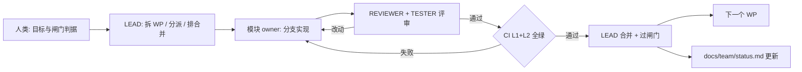

# 长期执行 Agent Team 方案（提案）

> 2026-10-19。目标：让 agent 团队持续、可并行、可审计地把工作包（WP）做完，人类只在闸门与取舍上介入。
> 与 [Agent 层架构基调](agent-core.md)、[实施路线](roadmap.md) 配套；本文只定义"怎么组织人和 agent"，不改产品设计。

## 0. 五个原则

1. **写、审、测分离**：作者不评审自己的 PR；评审专家与测试专家有 block 权。
2. **一个 WP 一个分支一个 owner**：分支短命，合并线性，回滚以 WP 为单位。
3. **契约先行，测试即规格**：改契约必须先改测试与文档，再改实现。
4. **机器闸门优先**：能用 CI 卡住的，不靠口头约定；人类只做判断。
5. **人类保留否决权**：合并、发布、契约变更、安全决策的最终确认在人。

## 1. 角色编制

### 1.1 常驻角色（durable）

| 角色 | 职责 | 权限 | 产出 |
|---|---|---|---|
| **TEAM LEAD**（人类，或人类 + 代理 Lead） | 拆 WP、分派、排合并顺序、过闸门、写 ADR、裁决冲突 | 合并 main、批准契约变更、启动/停止团队 | WP 列表、闸门记录、ADR |
| **REVIEWER**（代码质量与评审专家） | 审所有 PR；维护 lint/类型/规范；检查十条不变量；合并前最后一道 | block、要求补测试/拆 PR | 评审意见（含检查清单）、质量报告 |
| **TESTER**（测试专家） | 测试金字塔、契约测试、故障注入、夹具、flaky 治理、性能与长跑 | block（缺测试/契约不符） | 测试计划、夹具、CI 配置、覆盖率/长跑报告 |
| **OPS/SEC**（可与 REVIEWER 兼任） | 容器、日志、指标、备份恢复、凭据与依赖、暴露面 | 对发布与安全项 block | 运维清单、恢复演练记录 |

### 1.2 模块负责人（按 lane 常驻或按 WP 轮换）

| 角色 | 拥有范围 | 对应 lane |
|---|---|---|
| **STORAGE OWNER** | `apps/server/src/storage/**`、迁移、备份、状态 schema | A |
| **API OWNER** | `apps/server/src/api/**`、鉴权、AG-UI 投影 | B |
| **DOMAIN OWNER** | `apps/server/src/domain/**`、`runtime/**`、任务语义 | C |
| **ADAPTER/OPS OWNER** | `apps/server/src/adapters/**`、`deploy/**`、`infra/**` | D |

### 1.3 临时角色（ephemeral）

调研、一次性 spike、文档审计用 **subagent**，不进入常驻编制；产出结论进文档，不持有写权限。

### 1.4 规模建议

- **最小可行**：LEAD + REVIEWER + TESTER + 1 个开发（按 lane 轮换）= 4。
- **推荐**：LEAD + REVIEWER + TESTER + 4 个模块 owner = 7（但**同时活跃的 lane 不超过 3 条**，其余做评审、准备与测试夹具）。
- 角色可以一人多岗，但 **作者 ≠ 评审者** 必须成立。

## 2. 模型与评审独立性（先回答现状）

- 当前会话里 6 个分析 teammate 全部是 `deepseek-flash`，与 Lead 同一个模型；subagent 没有模型参数，继承会话默认，也没有被覆盖。
- **同质化风险**：同一模型写的和审的容易有相同盲区。缓解：
  1. REVIEWER 与 TESTER 用不同的系统提示与检查清单，不看作者的解释只看代码与测试；
  2. 关键 PR（契约/状态/安全）由人类抽查；
  3. 如果 harness 支持，给 REVIEWER 配不同模型或不同 temperature（workflow 的 agent 支持 `model`/`provider` 覆盖；teammate 当前不暴露该参数，需要确认）；
  4. 用机器检查补齐：lint、类型、契约 schema、变异测试（可选）。

## 3. Git 工作流

### 3.1 分支模型：trunk-based + 短命分支

| 分支 | 用途 | 生命周期 | 合并方式 |
|---|---|---|---|
| `main` | 唯一集成分支，受保护 | 永久 | 只接受 PR |
| `wp/<n>-<slug>` | 一个工作包（如 `wp1-server-skeleton`） | 一个 WP | squash 进 main |
| `test/<slug>` | 测试先行、夹具、契约测试 | 一个 WP | squash |
| `spike/<slug>` | 验证性探索，可能不产出代码 | 按范围，不按时间 | 只合决策文档 |
| `fix/<slug>` | 缺陷修复 | 短 | squash + patch tag |
| `docs/<slug>` | 文档/ADR | 短 | squash |

规则：

1. **一个 WP = 一个分支 = 一个 PR**；分支从最新 `main` 切出，评审前 rebase 到 main。
2. **禁止直接 push main**；squash merge，保持线性历史；merge commit 只在发布时打 tag。
3. **PR 体量预算**：非测试/文档改动 ≤ 400 行；迁移、契约变更各自独立 PR。
4. **分支寿命不超过一个闸门**；超了就拆 WP。
5. **并发 lane ≤ 3**；分支名带 WP 编号，便于和任务板对齐。
6. **禁止 force-push main**；分支可 rebase。
7. **发布标签**：每个闸门 `gate-g1 … gate-g5`；可用版本 `v0.1.0`（G2）、`v0.2.0`（G4）、`v1.0.0`（G5）。

### 3.2 保护规则（main）

- 必须走 PR；至少 1 个 approval（契约/状态/安全 PR 需要 2 个）。
- 必需检查：`ci-fast`、`ci-integration`、`secret-scan`。
- 分支必须与 main 同步；线性历史；禁止 force push；禁止删除。
- 只有人类 LEAD（或授权 bot）能合并；agent 只能创建/更新 PR。

### 3.3 Agent 的 GitHub 身份

两种方案，建议 **B**：

- **A 单一 token**：所有 agent 用人类账号 token。简单，但评审记录分不清谁审的。
- **B 每个角色一个 bot 账号**（`point-reviewer-bot`、`point-tester-bot`，可选 `point-dev-bot`）：权限最小化，CODEOWNERS 与 review 记录清晰，能配置"作者不能自审"。代价是多一套 token 管理。

### 3.4 分支与任务板联动

任务板（team_task 或 GitHub Issues）每条 = 一个 WP，字段：owner、lane、write scope、blocked_by、验收命令。分支名与 PR 标题都带 WP 编号；合并顺序按依赖图，不按提交时间。

## 4. 质量闸门（CI 分层）

| 层 | 何时 | 内容 | 目标时长 |
|---|---|---|---|
| **L1 ci-fast** | 每个 PR push | 安装、语法、**lint/format**、**类型检查**、单元测试、不变量 grep、secret scan | ≤ 5 min |
| **L2 ci-integration** | PR 标记 ready | 28 项离线套件（1 轮强杀）、API/AG-UI 契约测试、迁移夹具（v1→v2→重启→回滚）、文档链接 | ≤ 15 min |
| **L3 nightly** | 每晚 | 10 轮强杀（70 次）、`test:real`、`test:steel`（浏览器相关时）、1 小时 soak、性能预算、依赖审计 | ≤ 60 min |
| **L4 gate** | 过闸门前 | 7 天长跑、备份恢复演练、威胁评审、真实使用验收 | 人工 |

**当前缺口**（REVIEWER/TESTER 的第一批任务）：

- 没有 lint/format/类型检查 → 加 `eslint`、`prettier`、`tsc --checkJs`（或逐步迁 TS）。
- 没有覆盖率门槛 → 新代码行覆盖 ≥ 80%，`domain/`、`storage/` ≥ 90%。
- 没有契约测试目录 → `test/contract/`，含 AG-UI 事件 schema（vendored）与 REST 错误矩阵。
- 没有不变量机器检查 → 脚本化 grep：`domain` 不得 import steel/cdp/puppeteer/rtc；`domain` 不得出现 `defineTask`；`package.json` 不得出现 `^`/`~`；不得出现第二引擎依赖。
- 没有夜间任务 → 加 `nightly.yml`；长跑结果进 `evidence/`。
- 没有 flaky 治理 → 失败用例自动进 quarantine 列表，owner 在一个 WP 内修复。

## 5. 评审协议

### 5.1 谁必须审什么

| 改动类型 | 必需评审 |
|---|---|
| 普通实现 | REVIEWER |
| 测试/夹具/CI | TESTER + REVIEWER |
| 状态 schema、迁移、事务边界 | STORAGE OWNER + REVIEWER + **人类 LEAD 终审** |
| API/AG-UI 契约、错误码 | API OWNER + REVIEWER + **人类 LEAD 终审** |
| 安全、凭据、依赖、部署 | OPS/SEC + REVIEWER |
| 文档/ADR | REVIEWER（ADR 需人类 LEAD 批准） |

### 5.2 评审检查清单（每次评审必须逐条勾）

1. 事务边界是否明确？同一业务结果是否一个 commit？
2. 写操作是否有幂等键？重放是否安全？
3. 外部副作用是否三态（done/unknown/failed）？`unknown` 是否禁止自动重放？
4. 状态字段变更是否有迁移与回滚路径？版本闸门是否处理？
5. `domain` 是否仍然不依赖具体实现（资源走接口）？
6. 错误是否分类并映射到契约错误码？是否有"模型自信掩盖工具失败"的路径？
7. 新增/修改路径是否有对应测试（单元/契约/故障注入）？
8. 文档、`verification-status`、`evidence` 是否同步？
9. 性能敏感路径（snapshot/SSE/迁移）是否有规模断言？
10. PR 是否只动了本 WP 的写作用域？

### 5.3 规则

- 作者不能自审；REVIEWER 必须给出**至少一条实质性意见**，不能只写 LGTM。
- 评审轮次上限 2 轮；第 3 轮仍不过 → LEAD 介入拆分或重设计。
- 不同意可以 block，升级到 LEAD；架构分歧写 ADR。
- 评审意见要么解决，要么显式转为 issue 并标 `deferred`，不允许静默忽略。
- 合并前 CI 必须全绿；"先合后修"只允许 LEAD 在 `fix/` 分支上操作。

## 6. 测试专家（TESTER）职责

1. **测试金字塔**：单元（纯函数）→ 集成（进程 + SQLite + HTTP）→ 契约（REST/AG-UI）→ 故障注入（SIGKILL 窗口）→ 长跑。
2. **夹具**：v1 状态库、100 job/10 chat 性能夹具、faux provider、Steel stub、AG-UI schema、迁移前后快照。
3. **契约测试**：错误码矩阵、重放字节级相等、迁移语义等值、AG-UI 未知事件容忍与截断流。
4. **故障注入**：每新增一个状态变更，必须补对应窗口的强杀用例（DoD）。
5. **flaky 政策**：不允许靠 retry 掩盖；隔离 + 限期修复；记录 flake 率。
6. **性能预算**：`/state` p95、SSE 帧量、迁移耗时、长跑内存/句柄。
7. **长跑**：nightly 1h，闸门前 7 天；输出进 `evidence/`。
8. **门禁**：缺测试的 PR 直接 block。

## 7. 并行执行机制

- **lane 之间文件互斥**（见 roadmap §3）：A 状态/读模型、B 接口/协议、C 领域行为、D 运维/止血。
- **同一 lane 串行**，一个 lane 同时只有一个 owner。
- **同时活跃 ≤ 3 条 lane**；其余人做评审、夹具、文档、下一 WP 的准备。
- **派活三件套**：WP 编号 + 允许写的路径 + 验收命令；禁止写别人的路径。
- **依赖用 blocked_by 表达**，不靠口头同步；合并按依赖顺序。
- **冲突处理**：需要动别人 lane 的文件 → 先升级为串行或换 owner，不允许"顺手改一下"。

## 8. 长期执行循环

- **状态载体**：任务板 + PR + `docs/team/status.md`（每个闸门更新一次：已完成 WP、当前风险、下一步）。
- **人类介入点**：过闸门、契约变更、安全、两次评审失败、lane 冲突、预算超限。
- **定期动作**：每闸门做一次依赖评估、flake 复盘、ADR 回顾；每季度评估 pi-durable 升级。

## 9. 落地清单（按依赖）

**T0（团队启动前，REVIEWER/TESTER 的第一批 WP）**
- [ ] `.github/CODEOWNERS`、PR 模板、WP issue 模板、标签体系
- [ ] `main` 保护规则（必需检查、线性历史、禁止 force push）
- [ ] 拆 CI：`ci-fast.yml`、`ci-integration.yml`、`nightly.yml`；保留 `secret-scan`
- [ ] 加 `eslint` + `prettier` + 类型检查；不变量 grep 脚本
- [ ] `test/contract/` 目录与 AG-UI schema 夹具
- [ ] 评审检查清单落地为 `docs/team/review-checklist.md`
- [ ] `docs/team/status.md` 初始版

**T1（用真实 WP 跑通流程）**
- [ ] 用 WP1（骨架）+ WP10（浏览器止血）做试点，两条 lane 并行
- [ ] 记录：评审轮次、CI 时长、flaky、合并冲突
- [ ] 根据试点调整角色与闸门

**T2（扩到 3 条 lane）**
- [ ] 开 WP3/WP4 并行（A/B lane）
- [ ] REVIEWER/TESTER 固定排期，LEAD 只在闸门与冲突时介入

**T3（稳定运行）**
- [ ] 每闸门复盘；团队规模与并行度按数据调，不按感觉
- [ ] 可选：变异测试、依赖自动升级、成本预算告警

## 10. 风险与反模式

| 风险 | 表现 | 对策 |
|---|---|---|
| 橡皮图章评审 | "LGTM"、不提实质问题 | 必须至少一条实质意见；人类抽查；评审质量纳入复盘 |
| 同模型盲区 | 作者与评审错在同一个地方 | 不同提示/模型；机器检查；契约测试兜底 |
| 范围蔓延 | PR 顺手改别的模块 | 写作用域 + 第 10 条检查清单 + 体积预算 |
| 分支堆积 | 长期不合并、冲突不断 | 一个闸门内必须合并；并发 ≤ 3 |
| 权限绕过 | agent 直接 push main | 分支保护 + 合并权只给人类/bot |
| 过度流程 | 每个小改动都要两个评审 | 分级评审：普通 1 审，契约/状态 2 审 + 人类终审 |
| 成本失控 | 评审循环无限、并行太多 | 评审 ≤ 2 轮；并行 ≤ 3；测试先行减少返工 |
| 角色自审 | 同一 agent 既写又审 | 任务板记录 author/reviewer，CI 检查不同身份 |

## 11. 需要人类现在决定的三件事

1. **团队规模**：4（LEAD + REVIEWER + TESTER + 1 开发轮换）还是 7（4 模块 owner + REVIEWER + TESTER + LEAD）？
2. **GitHub 身份**：共用一个人类 token，还是给 REVIEWER/TESTER 单独开 bot 账号？
3. **评审强度**：普通 PR 1 审 / 契约、状态、安全 2 审 + 人类终审（推荐），还是所有 PR 都 2 审？

另外可选：是否让 REVIEWER 跑在与开发不同的模型上（减少同质化盲区）。
